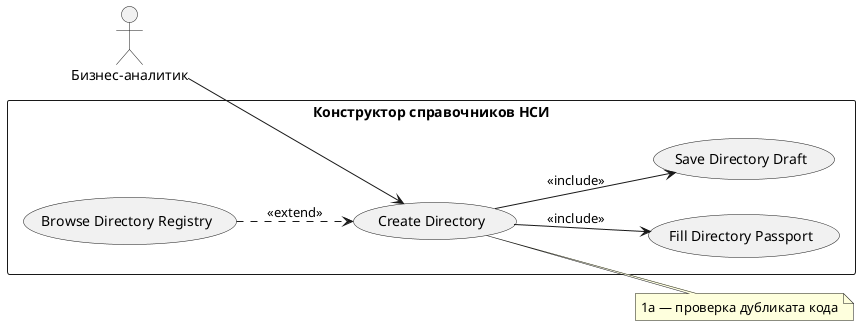

# USE CASE 01 | Create Directory

| Поле | Содержание |
|---|---|
| **USE CASE 01** | Create Directory |
| **Описание** | Бизнес-аналитик создаёт новый справочник и ожидает получить его черновик, готовый к заполнению паспорта и схемы данных. |
| **Используется в** | N/A |
| **Предусловия** | Пользователь вошёл в систему под ролью, позволяющей создавать справочники. Конструктор справочников доступен. |
| **Условие успешного завершения** | Создан черновик справочника (тип «Пользовательский»). Паспорт доступен для заполнения, конструктор схемы данных открыт. Справочник появился в списке «Мои справочники» (черновик). |
| **Условие завершения с ошибкой** | Черновик не создан. Список справочников не изменён. Отображена причина (отсутствие прав, дублирующий код, сбой сервера). |
| **Акторы** | Бизнес-аналитик (первичный — инициатор создания). |
| **Стимул** | Пользователь нажимает «Создать справочник» в реестре НСИ. |

## ОСНОВНОЙ ПОТОК (DESCRIPTION)

| Шаг | Действие |
|---|---|
| 1 | Бизнес-аналитик нажимает «Создать справочник». |
| 2 | Система проверяет, что у пользователя достаточно прав на создание справочника. |
| 3 | Система создаёт новый черновик справочника с типом «Пользовательский». |
| 4 | Система открывает конструктор: заполняет пустой паспорт справочника. |
| 5 | Система готовит пустую схему данных (таблица полей). |
| 6 | Система отображает панель действий («Сохранить справочник», «Опубликовать», «Перейти к записям»). |
| 7 | Система сохраняет созданный черновик (use case 06). |

## РАСШИРЕНИЯ (EXTENSIONS)

| Шаг | Ветвление |
|---|---|
| 2a | У пользователя недостаточно прав: 2a1. Система отображает «Недостаточно прав для выполнения операции». 2a2. Завершить сценарий. |
| 1a | Пользователь вводит код, который уже занят в реестре НСИ: 1a1. Система выполняет use case 10 (Browse Directory Registry) для проверки дубликата. 1a2. При обнаружении дубликата — отображает причину, завершает сценарий; при отсутствии — продолжает с шага 3. |

## ВАРИАЦИИ (VARIATIONS)

| Шаг | Вариант |
|---|---|
| 1 | Создание может быть инициировано: · кнопкой «Создать справочник» в реестре НСИ · переходом на маршрут нового справочника (directories/new/builder) |

## СВЯЗИ С ДРУГИМИ USE CASE

- Включает: Fill Directory Passport (use case 02) — шаг 4.
- Включает: Save Directory Draft (use case 06) — шаг 7.
- Расширяется: Browse Directory Registry (use case 10) — условно, при проверке дубликата кода (расширение 1a).

## ДИАГРАММА USE CASE

Собственная диаграмма сценария: [`Диаграмма UC-01.png`](Диаграмма%20UC-01.png). Системная диаграмма — в файле «Диаграмма Use Case системы».

