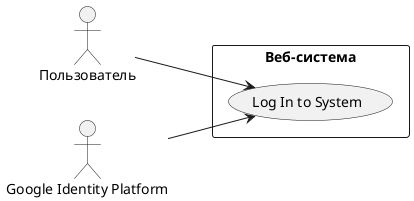

# USE CASE 01 | Log In to System

| Поле | Содержание |
|---|---|
| **USE CASE 01** | Log In to System |
| **Описание** | Пользователь инициализирует вход в веб-систему, ожидает получить доступ к персональному разделу, используя свой аккаунт Google, без отдельной регистрации и пароля. |
| **Используется в** | N/A |
| **Предусловия** | 1. Для пользователя существует запись аккаунта Google. 2. На стороне системы зарегистрирован OAuth-клиент (идентификатор клиента, области доступа, адрес возврата). 3. Сервис авторизации Google доступен. |
| **Условие успешного завершения** | 1. В системе создана активная сессия пользователя (появилась запись сессии с идентификатором входа). 2. В системе сохранены идентификатор, имя и e-mail пользователя, полученные от Google (создана/обновлена запись профиля). 3. Результат для пользователя: доступ к персональному разделу открыт — защищённые страницы возвращают контент вместо перехода на вход. 4. Результат для системы: пользователь идентифицирован и аутентифицирован, последующие запросы привязываются к его сессии. |
| **Условие неудачного завершения** | 1. Не создана сессия пользователя — в хранилище сессий отсутствует запись для него. 2. Не сохранены и не изменены данные профиля (идентификатор, имя, e-mail). 3. Не выдан доступ к персональному разделу: запрос к защищённому ресурсу завершается переходом на страницу входа. 4. Частично начатый вход откатывается: параметры защиты входа (state, nonce, код подтверждения) из сессии удаляются, повторно выданные токены не используются, повторный запрос пользователя не признаётся ранее начатым входом. |
| **Акторы** | **Основной:** Пользователь — человек, инициирует вход, ожидает доступ к персональному разделу. **Вторичные:** Google Identity Platform — внешний сервис авторизации: проверяет личность Пользователя, выдаёт код подтверждения и токены. |
| **Стимул** | Пользователь нажимает кнопку «Войти» на странице входа. |

## ОСНОВНОЙ ПОТОК

| Шаг | Действие |
|---|---|
| 1 | Пользователь нажимает кнопку «Войти» на странице входа. |
| 2 | Система генерирует параметры защиты входа (state, nonce, код подтверждения PKCE). |
| 3 | Система сохраняет параметры защиты входа в сессии пользователя. |
| 4 | Система перенаправляет пользователя на страницу входа Google Identity Platform с запросом областей доступа. |
| 5 | Пользователь выполняет вход в Google Identity Platform. |
| 6 | Пользователь даёт согласие на передачу запрошенных данных. |
| 7 | Google Identity Platform возвращает пользователя на систему с кодом подтверждения и параметром state. |
| 8 | Система проверяет полученный параметр state на соответствие сохранённому. |
| 9 | Система направляет в Google Identity Platform запрос обмена кода на токены (код подтверждения, код PKCE, идентификатор клиента). |
| 10 | Google Identity Platform выдаёт системе access-токен, ID-токен и refresh-токен. |
| 11 | Система проверяет успешность ответа на запрос обмена токенов. |
| 12 | Система проверяет подпись ID-токена по публичным ключам Google Identity Platform. |
| 13 | Система проверяет издателя (iss) и получателя (aud) ID-токена. |
| 14 | Система проверяет срок действия (exp) и параметр nonce ID-токена. |
| 15 | Система создаёт сессию пользователя. |
| 16 | Система сохраняет данные профиля пользователя (идентификатор, имя, e-mail). |
| 17 | Система предоставляет пользователю доступ к персональному разделу. |

## РАСШИРЕНИЯ

| Шаг | Ветвление |
|---|---|
| **4a** | **Сервис Google Identity Platform недоступен в момент перенаправления:** 4a1. Система отображает пользователю сообщение о временной недоступности входа. 4a2. Система удаляет параметры защиты входа из сессии. → Завершение с ошибкой (состояние по Условию неудачного завершения). |
| **5a** | **Вход пользователя в Google Identity Platform не выполнен (неверные учётные данные, проваленная проверка MFA):** 5a1. Google Identity Platform отображает пользователю причину отказа. 5a2. При повторной попытке — вернуться к шагу 5. 5a3. При отказе от входа — продолжить с ветвления 6b. |
| **6b** | **Пользователь отказывается от входа или закрывает страницу Google Identity Platform:** 6b1. Google Identity Platform возвращает системе сигнал об отказе. 6b2. Система удаляет параметры защиты входа из сессии. → Завершение с ошибкой (состояние по Условию неудачного завершения). |
| **8a** | **Полученный параметр state не совпал с сохранённым (попытка подделки запроса):** 8a1. Система прерывает обработку и фиксирует событие в журнале безопасности. 8a2. Система удаляет параметры защиты входа из сессии. → Завершение с ошибкой (состояние по Условию неудачного завершения). |
| **10a** | **Google Identity Platform отклонила обмен кода на токены (код просрочен, уже использован или код PKCE не подтверждён):** 10a1. Система фиксирует событие в журнале безопасности. 10a2. Система удаляет параметры защиты входа из сессии. → Завершение с ошибкой (состояние по Условию неудачного завершения). |
| **11a** | **Ответ на запрос обмена токенов не успешен:** 11a1. Система фиксирует событие в журнале безопасности. 11a2. Система удаляет параметры защиты входа из сессии. → Завершение с ошибкой (состояние по Условию неудачного завершения). |
| **12a** | **Подпись ID-токена не подтверждена по публичным ключам Google Identity Platform:** 12a1. Система отклоняет ID-токен. 12a2. Система фиксирует событие в журнале безопасности. 12a3. Система удаляет параметры защиты входа из сессии. → Завершение с ошибкой (состояние по Условию неудачного завершения). |
| **13a** | **Издатель (iss) или получатель (aud) ID-токена не совпадают с ожидаемыми:** 13a1. Система отклоняет ID-токен. 13a2. Система фиксирует событие в журнале безопасности. 13a3. Система удаляет параметры защиты входа из сессии. → Завершение с ошибкой (состояние по Условию неудачного завершения). |
| **14a** | **ID-токен просрочен или его параметр nonce не совпал с сохранённым (повторное использование токена):** 14a1. Система отклоняет ID-токен. 14a2. Система фиксирует событие в журнале безопасности. 14a3. Система удаляет параметры защиты входа из сессии. → Завершение с ошибкой (состояние по Условию неудачного завершения). |
| **15a** | **Создание сессии завершено сбоем:** 15a1. Система не выдаёт доступ и отображает пользователю сообщение об ошибке. 15a2. Система удаляет параметры защиты входа из сессии. → Завершение с ошибкой (состояние по Условию неудачного завершения). |
| **16a** | **Сохранение профиля завершено сбоем (сессия уже создана):** 16a1. Система откатывает сессию пользователя, созданную на шаге 15 (не оставляется незавершённая сессия). 16a2. Система не выдаёт доступ и отображает пользователю сообщение об ошибке. 16a3. Система удаляет параметры защиты входа. → Завершение с ошибкой (состояние по Условию неудачного завершения). |

## ВАРИАЦИИ

| Шаг | Вариант |
|---|---|
| 1 | Пользователь может инициировать вход: • с браузера на настольном компьютере; • с браузера на мобильном устройстве. |
| 5 | Пользователь может выполнить вход в Google Identity Platform: • по логину и паролю; • с проверкой подлинности (MFA); • через связанный социальный вход провайдера. |

## СВЯЗИ С ДРУГИМИ USE CASE

- Ничего не включает; не является расширением.
- Вызывается (переход на страницу входа): UC-02 (расширения 2a, 4a), UC-03 (расширения 3b, 4a, 5a, 6a).

## ДИАГРАММА USE CASE

Собственная диаграмма сценария: [`Диаграмма UC-01.png`](Диаграмма%20UC-01.png). Системная диаграмма всех пяти сценариев — в файле «Диаграмма Use Case системы».

