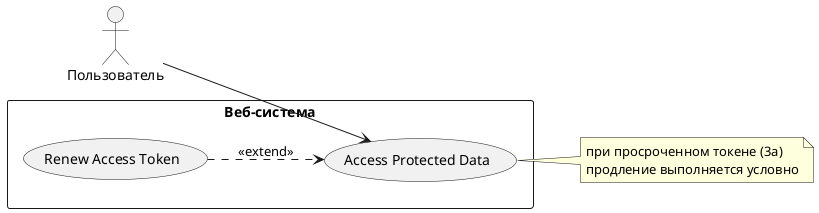

# USE CASE 02 | Access Protected Data

| Поле | Содержание |
|---|---|
| **USE CASE 02** | Access Protected Data |
| **Описание** | Авторизованный пользователь обращается за своими персональными данными, ожидает получить данные, не выполняя повторный вход в систему. |
| **Используется в** | N/A |
| **Предусловия** | 1. У пользователя в системе активна сессия. 2. На стороне системы хранится access-токен пользователя. |
| **Условие успешного завершения** | 1. Данные защищённого ресурса переданы пользователю. 2. Результат для пользователя: доступ к данным без повторного ввода пароля. 3. Результат для системы: обращение к данным привязано к идентификатору пользователя и зафиксировано. |
| **Условие неудачного завершения** | 1. Данные защищённого ресурса не раскрыты. 2. Записей о доступе к данным пользователя не создано. 3. У пользователя нет доступа к защищённым ресурсам до завершения сценария входа в систему. |
| **Акторы** | **Основной:** Пользователь — человек, обращается за своими персональными данными. **Вторичные:** отсутствуют — сервисы сценария (внутренний API, хранилище токенов) находятся внутри системы. |
| **Стимул** | Пользователь запрашивает защищённый ресурс (открывает защищённую страницу). |

## ОСНОВНОЙ ПОТОК

| Шаг | Действие |
|---|---|
| 1 | Пользователь запрашивает защищённый ресурс. |
| 2 | Система проверяет действующую сессию пользователя. |
| 3 | Система проверяет срок действия access-токена пользователя. |
| 4 | Система проверяет предъявленный access-токен (подпись, получатель, срок действия). |
| 5 | Система передаёт пользователю данные защищённого ресурса. |

## РАСШИРЕНИЯ

| Шаг | Ветвление |
|---|---|
| **2a** | **Сессия пользователя недействительна (отсутствует или завершена):** 2a1. Система отказывает в доступе к ресурсу. 2a2. Система перенаправляет пользователя на страницу входа (use case 01). → Завершение с ошибкой (состояние по Условию неудачного завершения). |
| **3a** | **Access-токен просрочен:** 3a1. Система обновляет access-токен (use case 03). 3a2. Продолжить с шага 3. |
| **4a** | **Предъявленный access-токен не подтверждён (подпись, получатель или срок не пройдены):** 4a1. Система отказывает в доступе к ресурсу и фиксирует событие в журнале безопасности. 4a2. Система перенаправляет пользователя на страницу входа (use case 01). → Завершение с ошибкой (состояние по Условию неудачного завершения). |

## ВАРИАЦИИ

N/A — альтернативные способы выполнения шагов основного потока в данном сценарии не определены.

## СВЯЗИ С ДРУГИМИ USE CASE

- Расширяется: Renew Access Token (use case 03) — условно, при просроченном access-токене (расширение 3a).
- Вызывает: Log In to System (use case 01) — при недействительной сессии (2a) или неподтверждённом токене (4a).

## ДИАГРАММА USE CASE

Собственная диаграмма сценария: [`Диаграмма UC-02.png`](Диаграмма%20UC-02.png). Системная диаграмма всех пяти сценариев — в файле «Диаграмма Use Case системы».

