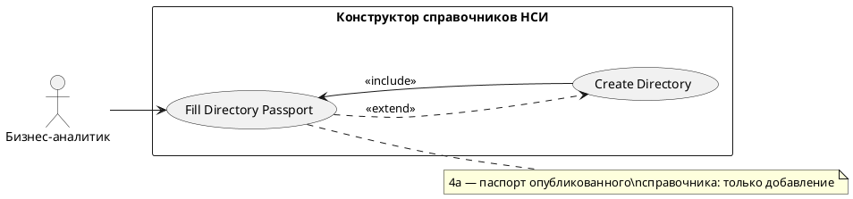

# USE CASE 02 | Fill Directory Passport

| Поле | Содержание |
|---|---|
| **USE CASE 02** | Fill Directory Passport |
| **Описание** | Бизнес-аналитик заполняет паспорт справочника (код, наименование, тип, обозначение, даты, назначение, аннотацию и др.) и ожидает получить корректный паспорт. |
| **Используется в** | N/A |
| **Предусловия** | Открыт черновик справочника (создан — use case 01). Паспорт доступен для редактирования. |
| **Условие успешного завершения** | Обязательные поля паспорта заполнены (код ≤100, наименование ≤3000). Тип, даты начала/окончания, степень конфиденциальности, метод систематизации заданы. Паспорт отображается в карточке «Справочник». |
| **Условие завершения с ошибкой** | Паспорт не заполнен/не валиден. Справочник остаётся в текущем состоянии. Отображены причины (незаполненные обязательные поля, дублирующий код). |
| **Акторы** | Бизнес-аналитик (первичный). |
| **Стимул** | Пользователь заполняет поля паспорта в конструкторе. |

## ОСНОВНОЙ ПОТОК (DESCRIPTION)

| Шаг | Действие |
|---|---|
| 1 | Бизнес-аналитик вводит код и наименование справочника. |
| 2 | Система валидирует код (≤100 символов) и наименование (≤3000 символов). |
| 3 | Пользователь задаёт тип справочника (Пользовательский, Технологический, Защищенный (классификатор)). |
| 4 | Пользователь задаёт обозначение, аббревиатуру, операторов. |
| 5 | Пользователь задаёт дату начала и дату окончания (или «Бессрочно»). |
| 6 | Пользователь прикрепляет акт о дате начала и акт о дате окончания (при наличии). |
| 7 | Пользователь заполняет назначение, аннотацию, ключевые слова, метод систематизации, степень конфиденциальности. |
| 8 | Система отображает заполненный паспорт в карточке «Справочник». |

## РАСШИРЕНИЯ (EXTENSIONS)

| Шаг | Ветвление |
|---|---|
| 2a | Код дублируется или поле не соответствует ограничениям: 2a1. Система отображает причину ошибки. 2a2. Продолжить с шага 1 (пользователь исправляет данные). |
| 4a | Справочник уже опубликован и его паспорт редактируется по вторичной схеме (дополнительное уточнение): 4a1. Система разрешает только добавление новых элементов, а не изменение наименования, типа, кода и существующей структуры. 4a2. Продолжить с шага 5. |
| 5a | Пользователь выбирает «Бессрочно» для даты окончания: 5a1. Система оставляет поле даты окончания пустым и отображает «Бессрочно». 5a2. Продолжить с шага 6. |

## ВАРИАЦИИ (VARIATIONS)

| Шаг | Вариант |
|---|---|
| 3 | Тип справочника может быть: · Пользовательский (по умолчанию) · Технологический · Защищенный (классификатор) — доступ только пользователям организации |

## СВЯЗИ С ДРУГИМИ USE CASE

- Включается в: Create Directory (use case 01, шаг 4) — для нового справочника.
- Расширяется: Create Directory (use case 01) — условно, при редактировании паспорта опубликованного справочника (расширение 4a).

## ДИАГРАММА USE CASE

Собственная диаграмма сценария: [`Диаграмма UC-02.png`](Диаграмма%20UC-02.png). Системная диаграмма — в файле «Диаграмма Use Case системы».

