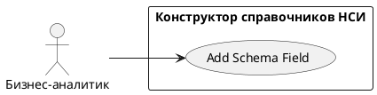

# USE CASE 03 | Add Schema Field

| Поле | Содержание |
|---|---|
| **USE CASE 03** | Add Schema Field |
| **Описание** | Бизнес-аналитик добавляет поле (или вложенный объект с дочерними полями) в схему данных справочника и ожидает, что поле появится в таблице схемы с заданными характеристиками. |
| **Используется в** | N/A |
| **Предусловия** | Открыт черновик справочника со схемой данных. |
| **Условие успешного завершения** | Поле отображено в таблице схемы (колонки: код, название, описание). Тип, обязательность и (при наличии) дочерние поля заданы. |
| **Условие завершения с ошибкой** | Поле не добавлено. Схема не изменена. Отображена причина (дублирующий код поля, незаполненный код/название). |
| **Акторы** | Бизнес-аналитик (первичный). |
| **Стимул** | Пользователь нажимает «Добавить поле» (или раскрывает объект и добавляет дочернее поле). |

## ОСНОВНОЙ ПОТОК (DESCRIPTION)

| Шаг | Действие |
|---|---|
| 1 | Бизнес-аналитик нажимает «Добавить поле» на нужном уровне вложенности. |
| 2 | Система отображает форму нового поля. |
| 3 | Пользователь задаёт код поля, название поля, описание поля. |
| 4 | Пользователь задаёт тип поля. |
| 5 | Пользователь задаёт обязательность поля. |
| 6 | Система проверяет код поля на дублирование в текущей ветке схемы. |
| 7 | Система добавляет поле в модель JSON-схемы и отображает его в таблице. |

## РАСШИРЕНИЯ (EXTENSIONS)

| Шаг | Ветвление |
|---|---|
| 6a | Код поля дублируется или обязательные атрибуты не заполнены: 6a1. Система отображает причину ошибки. 6a2. Продолжить с шага 3 (пользователь исправляет данные). |
| 7a | Пользователь добавляет объект и хочет раскрыть его: 7a1. Система раскрывает объект, позволяя добавлять дочерние поля (возврат в шаг 1 на вложенном уровне). 7a2. Продолжить с шага 7 после завершения вложенного добавления. |

## ВАРИАЦИИ (VARIATIONS)

| Шаг | Вариант |
|---|---|
| 1 | Поле может быть добавлено: · кнопкой «Добавить поле» (корневой уровень) · через раскрытие объекта (вложенный уровень) · через редактор JSON-схемы (ручной ввод кода схемы) |

## СВЯЗИ С ДРУГИМИ USE CASE

- Сам по себе не вызывает другие UC; используется внутри жизненного цикла справочника (UC-01/09).

## ДИАГРАММА USE CASE

Собственная диаграмма сценария: [`Диаграмма UC-03.png`](Диаграмма%20UC-03.png). Системная диаграмма — в файле «Диаграмма Use Case системы».

