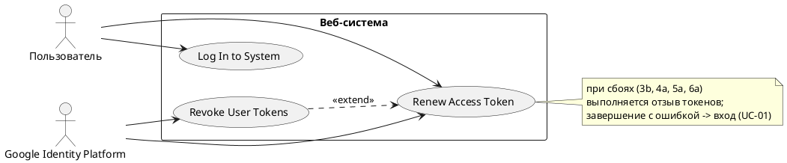

# USE CASE 03 | Renew Access Token

| Поле | Содержание |
|---|---|
| **USE CASE 03** | Renew Access Token |
| **Описание** | Система продлевает срок действия пропуска пользователя к собственным данным, ожидая, что пользователь продолжит работу без повторного входа. |
| **Используется в** | Access Protected Data (use case 02) |
| **Предусловия** | 1. У пользователя в системе активна сессия. 2. На стороне системы хранен действующий refresh-токен пользователя. |
| **Условие успешного завершения** | 1. На стороне системы сохранён новый access-токен со сроком действия. 2. Старый refresh-токен заменён новым (выполнена ротация). 3. Результат для пользователя: продолжение работы без повторного ввода пароля. 4. Результат для системы: доступ к данным пользователя продолжается, ротация refresh-токенов зафиксирована. |
| **Условие неудачного завершения** | 1. Новый access-токен не сохранён. 2. Сессия пользователя завершена и переведена в состояние, требующее повторного входа. 3. Пользователь лишён доступа к персональному разделу до завершения сценария входа в систему. |
| **Акторы** | **Основной:** Пользователь — человек, цель сценария (продолжение работы без повторного входа) принадлежит ему; сценарий запускается без его прямого действия. **Вторичные:** Google Identity Platform — внешний сервис авторизации: выдаёт новые токены по refresh-токену. |
| **Стимул** | Access-токен пользователя истёк (наступление времени истечения или отказ внутреннего API с признаком недействительного пропуска). |

## ОСНОВНОЙ ПОТОК

| Шаг | Действие |
|---|---|
| 1 | Система фиксирует истечение access-токена пользователя. |
| 2 | Система извлекает refresh-токен пользователя из сессии. |
| 3 | Система направляет в Google Identity Platform запрос на новые токены, приложив refresh-токен. |
| 4 | Google Identity Platform выдаёт системе новый access-токен и новый refresh-токен. |
| 5 | Система сохраняет новый access-токен в сессии пользователя. |
| 6 | Система заменяет refresh-токен пользователя новым (ротация). |

## РАСШИРЕНИЯ

| Шаг | Ветвление |
|---|---|
| **3a** | **Google Identity Platform недоступна в момент запроса на новые токены:** 3a1. Система повторяет запрос на новые токены в пределах установленного времени ожидания. 3a2. При успешном повторе — Продолжить с шага 4. 3a3. При повторном отказе — Продолжить с ветвления 3b. |
| **3b** | **Google Identity Platform отклонила refresh-токен (отозван, просрочен или использован повторно):** 3b1. Система отзывает все токены пользователя (use case 05). 3b2. Система завершает сессию пользователя. 3b3. Система перенаправляет пользователя на страницу входа (use case 01). → Завершение с ошибкой (состояние по Условию неудачного завершения). |
| **4a** | **Ответ на запрос на новые токены не успешен:** 4a1. Система фиксирует событие в журнале безопасности. 4a2. Система отзывает все токены пользователя (use case 05). 4a3. Система завершает сессию пользователя. 4a4. Система перенаправляет пользователя на страницу входа (use case 01). → Завершение с ошибкой (состояние по Условию неудачного завершения). |
| **5a** | **Сохранение нового access-токена завершено сбоем:** 5a1. Система не использует выданные токены. 5a2. Система отзывает все токены пользователя (use case 05). 5a3. Система завершает сессию пользователя. 5a4. Система перенаправляет пользователя на страницу входа (use case 01). → Завершение с ошибкой (состояние по Условию неудачного завершения). |
| **6a** | **Замена refresh-токена (ротация) завершена сбоем:** 6a1. Система отзывает все токены пользователя (use case 05). 6a2. Система завершает сессию пользователя. 6a3. Система перенаправляет пользователя на страницу входа (use case 01). → Завершение с ошибкой (состояние по Условию неудачного завершения). |

## ВАРИАЦИИ

N/A — альтернативные способы выполнения шагов основного потока в данном сценарии не определены.

## СВЯЗИ С ДРУГИМИ USE CASE

- Является расширением: Access Protected Data (use case 02) — условно, при просроченном access-токене (расширение 3a того UC).
- Расширяется: Revoke User Tokens (use case 05) — условно, при сбоях (расширения 3b, 4a, 5a, 6a).
- Вызывает: Log In to System (use case 01) — при завершении с ошибкой.

## ДИАГРАММА USE CASE

Собственная диаграмма сценария: [`Диаграмма UC-03.png`](Диаграмма%20UC-03.png). Системная диаграмма всех пяти сценариев — в файле «Диаграмма Use Case системы».

