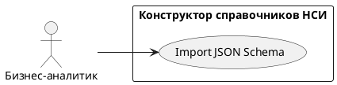

# USE CASE 04 | Import JSON Schema

| Поле | Содержание |
|---|---|
| **USE CASE 04** | Import JSON Schema |
| **Описание** | Бизнес-аналитик загружает схему данных в формате JSON (файлом или текстом) и ожидает, что система применит её к справочнику и отобразит в таблице полей. |
| **Используется в** | N/A |
| **Предусловия** | Открыт черновик справочника. |
| **Условие успешного завершения** | Схема из JSON применена: все поля (включая вложенные объекты) отображены в таблице схемы с кодом, названием, типом и обязательностью. |
| **Условие завершения с ошибкой** | Схема не применена. Текущая схема сохранена без изменений. Отображена причина (невалидный JSON, ошибки в структуре). |
| **Акторы** | Бизнес-аналитик (первичный). |
| **Стимул** | Пользователь нажимает «Импорт из JSON». |

## ОСНОВНОЙ ПОТОК (DESCRIPTION)

| Шаг | Действие |
|---|---|
| 1 | Бизнес-аналитик нажимает «Импорт из JSON». |
| 2 | Пользователь предоставляет JSON-схему (файл или текст). |
| 3 | Система проверяет синтаксис JSON. |
| 4 | Система проверяет структуру схемы (известные типы полей, атрибуты). |
| 5 | Система заменяет текущую схему данных на импортированную. |
| 6 | Система отображает импортированную схему в таблице полей. |

## РАСШИРЕНИЯ (EXTENSIONS)

| Шаг | Ветвление |
|---|---|
| 3a | JSON невалиден (синтаксическая ошибка): 3a1. Система отображает позицию и суть ошибки. 3a2. Продолжить с шага 2 (пользователь исправляет JSON). |
| 4a | В схеме неизвестный тип поля или неверная структура: 4a1. Система перечисляет некорректные элементы. 4a2. Продолжить с шага 2. |

## ВАРИАЦИИ (VARIATIONS)

| Шаг | Вариант |
|---|---|
| 2 | Схема может быть предоставлена: · файлом (загрузкой) · текстом в поле редактора |

## СВЯЗИ С ДРУГИМИ USE CASE

- Сам по себе не вызывает другие UC.

## ДИАГРАММА USE CASE

Собственная диаграмма сценария: [`Диаграмма UC-04.png`](Диаграмма%20UC-04.png). Системная диаграмма — в файле «Диаграмма Use Case системы».

