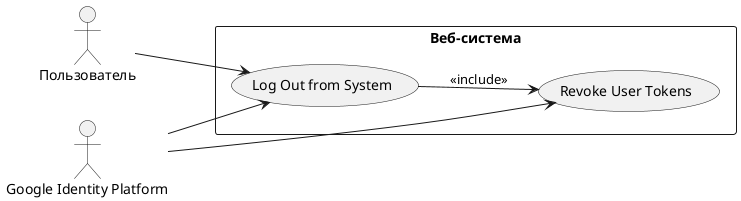

# USE CASE 04 | Log Out from System

| Поле | Содержание |
|---|---|
| **USE CASE 04** | Log Out from System |
| **Описание** | Авторизованный пользователь завершает работу с системой, ожидая, что доступ к его персональным данным будет отозван у него и у системы полностью. |
| **Используется в** | N/A |
| **Предусловия** | 1. У пользователя в системе активна сессия. 2. На стороне системы хранен действующий refresh-токен пользователя. |
| **Условие успешного завершения** | 1. Сессия пользователя завершена, доступ к персональному разделу закрыт. 2. Результат для пользователя: повторный запрос к защищённому ресурсу завершается переходом на страницу входа. 3. Результат для системы: пропуск пользователя (refresh-токен) отозван, повторное использование данных авторизации исключено. |
| **Условие неудачного завершения** | 1. Сессия пользователя не завершена (или завершена после отмены). 2. Данные авторизации (refresh-токен) не отозваны и могут быть использованы для восстановления доступа. 3. Пользователь сохраняет доступ к персональному разделу. |
| **Акторы** | **Основной:** Пользователь — человек, инициирует выход. **Вторичные:** Google Identity Platform — внешний сервис авторизации: отзывает refresh-токен, завершает сессию на своей стороне. |
| **Стимул** | Пользователь нажимает кнопку «Выйти» на странице системы. |

## ОСНОВНОЙ ПОТОК

| Шаг | Действие |
|---|---|
| 1 | Пользователь нажимает кнопку «Выйти» на странице системы. |
| 2 | Система отзывает refresh-токен пользователя (use case 05). |
| 3 | Система перенаправляет пользователя на страницу завершения сессии Google Identity Platform. |
| 4 | Google Identity Platform завершает сессию пользователя на своей стороне. |
| 5 | Система завершает сессию пользователя. |
| 6 | Система удаляет данные авторизации из сессии пользователя. |
| 7 | Система перенаправляет пользователя на страницу входа. |

## РАСШИРЕНИЯ

| Шаг | Ветвление |
|---|---|
| **2a** | **Отзыв refresh-токена не выполнен (Google Identity Platform недоступна):** 2a1. Система фиксирует неотозванный refresh-токен (отложенный отзыв в очереди). 2a2. Продолжить с шага 3. |
| **3a** | **Страница завершения сессии Google Identity Platform недоступна:** 3a1. Система пропускает завершение сессии на стороне Google Identity Platform. 3a2. Система фиксирует незавершённую сессию провайдера в журнале. 3a3. Продолжить с шага 5. |
| **5a** | **Завершение сессии завершено сбоем:** 5a1. Система повторяет завершение сессии. 5a2. При повторном отказе — система фиксирует сбой в журнале безопасности и сохраняет пользователю доступ до восстановления. 5a3. Продолжить с шага 6. |
| **6a** | **Удаление данных авторизации завершено сбоем:** 6a1. Система повторяет удаление данных авторизации. 6a2. При повторном отказе — система фиксирует сбой в журнале безопасности и сохраняет пользователю доступ до восстановления. 6a3. Продолжить с шага 7. |

## ВАРИАЦИИ

N/A — альтернативные способы выполнения шагов основного потока в данном сценарии не определены.

## СВЯЗИ С ДРУГИми USE CASE

- Включает: Revoke User Tokens (use case 05) — обязательно, на шаге 2.

## ДИАГРАММА USE CASE

Собственная диаграмма сценария: [`Диаграмма UC-04.png`](Диаграмма%20UC-04.png). Системная диаграмма всех пяти сценариев — в файле «Диаграмма Use Case системы».

