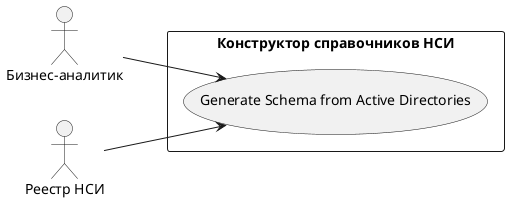

# USE CASE 05 | Generate Schema from Active Directories

| Поле | Содержание |
|---|---|
| **USE CASE 05** | Generate Schema from Active Directories |
| **Описание** | Бизнес-аналитик формирует схему данных справочника на основе структуры активных справочников реестра НСИ и ожидает получить предзаполненную схему. |
| **Используется в** | N/A |
| **Предусловия** | Открыт черновик справочника. В реестре НСИ есть активные справочники. |
| **Условие успешного завершения** | Схема данных сформирована из структуры выбранного(ых) активного(ых) справочника(ов) и отображена в таблице полей. |
| **Условие завершения с ошибкой** | Схема не сформирована. Текущая схема не изменена. Отображена причина (нет доступных активных справочников, сбой обращения к реестру). |
| **Акторы** | Бизнес-аналитик (первичный). Реестр НСИ (вторичный — источник активных справочников). |
| **Стимул** | Пользователь нажимает «Схема из активных справочников». |

## ОСНОВНОЙ ПОТОК (DESCRIPTION)

| Шаг | Действие |
|---|---|
| 1 | Бизнес-аналитик нажимает «Схема из активных справочников». |
| 2 | Система запрашивает список активных справочников у реестра НСИ. |
| 3 | Система отображает доступные активные справочники для выбора. |
| 4 | Пользователь выбирает источник(и) структуры. |
| 5 | Система формирует схему данных по выбранной структуре. |
| 6 | Система отображает сформированную схему в таблице полей. |

## РАСШИРЕНИЯ (EXTENSIONS)

| Шаг | Ветвление |
|---|---|
| 2a | Реестр НСИ недоступен или не вернул активных справочников: 2a1. Система отображает причину. 2a2. Завершить сценарий; схема не изменена. |
| 3a | Активных справочников нет: 3a1. Система отображает «нет доступных активных справочников». 3a2. Завершить сценарий. |

## ВАРИАЦИИ (VARIATIONS)

| Шаг | Вариант |
|---|---|
| 4 | Пользователь может выбрать: · один активный справочник · несколько активных справочников (объединение структур) |

## СВЯЗИ С ДРУГИМИ USE CASE

- Сам по себе не вызывает другие UC; использует внешнюю систему (реестр НСИ).

## ДИАГРАММА USE CASE

Собственная диаграмма сценария: [`Диаграмма UC-05.png`](Диаграмма%20UC-05.png). Системная диаграмма — в файле «Диаграмма Use Case системы».

