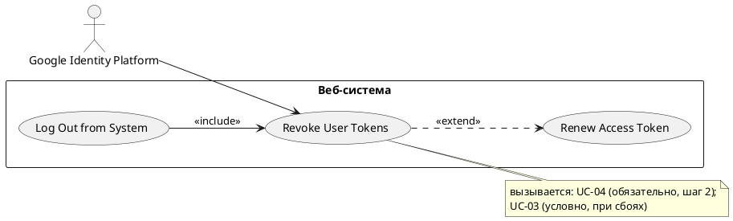

# USE CASE 05 | Revoke User Tokens

| Поле | Содержание |
|---|---|
| **USE CASE 05** | Revoke User Tokens |
| **Описание** | Система отзывает пропуск пользователя (refresh-токен) в Google Identity Platform, ожидая, что повторно выданный или украденный пропуск не сможет быть использован для восстановления доступа. |
| **Используется в** | Log Out from System (use case 04), Renew Access Token (use case 03) |
| **Предусловия** | 1. На стороне системы хранен refresh-токен пользователя. |
| **Условие успешного завершения** | 1. Refresh-токен пользователя отозван в Google Identity Platform. 2. Результат для пользователя: восстановление доступа по отозванному пропуску невозможно. 3. Результат для системы: отзыв refresh-токена зафиксирован. |
| **Условие неудачного завершения** | 1. Refresh-токен не отозван в Google Identity Platform. 2. Отложенный отзыв refresh-токена поставлен в очередь на повторное выполнение. 3. Система зафиксировала неотозванный refresh-токен до его отзыва. |
| **Акторы** | **Основной:** Пользователь — человек, безопасность токенов которого является целью сценария; сценарий запускается другим сценарием (use case 03 или use case 04). **Вторичные:** Google Identity Platform — внешний сервис авторизации: отзывает refresh-токен. |
| **Стимул** | Другой сценарий (use case 03 или use case 04) запрашивает отзыв refresh-токена пользователя. |

## ОСНОВНОЙ ПОТОК

| Шаг | Действие |
|---|---|
| 1 | Система извлекает refresh-токен пользователя из сессии. |
| 2 | Система направляет в Google Identity Platform запрос отзыва refresh-токена. |
| 3 | Google Identity Platform подтверждает отзыв refresh-токена. |
| 4 | Система фиксирует отзыв refresh-токена в журнале. |

## РАСШИРЕНИЯ

| Шаг | Ветвление |
|---|---|
| **2a** | **Refresh-токен уже отозван (Google Identity Platform отклонила повторный отзыв):** 2a1. Система фиксирует повторный отзыв в журнале безопасности. 2a2. Продолжить с шага 4. |
| **2b** | **Google Identity Platform недоступна в момент запроса отзыва:** 2b1. Система ставит отзыв refresh-токена в очередь на повторное выполнение. 2b2. Система фиксирует неотозванный refresh-токен в журнале безопасности. → Завершение с ошибкой (состояние по Условию неудачного завершения). |

## ВАРИАЦИИ

N/A — альтернативные способы выполнения шагов основного потока в данном сценарии не определены.

## СВЯЗИ С ДРУГИМИ USE CASE

- Включается в: Log Out from System (use case 04) — обязательно, на шаге 2.
- Расширяет: Renew Access Token (use case 03) — условно, при сбоях (расширения 3b, 4a, 5a, 6a того UC).

## ДИАГРАММА USE CASE

Собственная диаграмма сценария: [`Диаграмма UC-05.png`](Диаграмма%20UC-05.png). Системная диаграмма всех пяти сценариев — в файле «Диаграмма Use Case системы».

