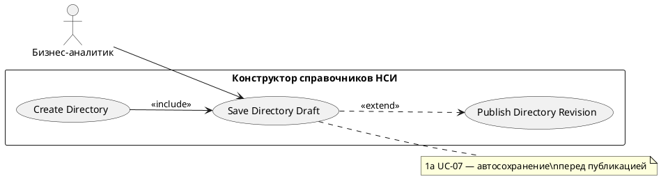

# USE CASE 06 | Save Directory Draft

| Поле | Содержание |
|---|---|
| **USE CASE 06** | Save Directory Draft |
| **Описание** | Бизнес-аналитик сохраняет текущее состояние справочника (паспорт + схему данных) как черновик и ожидает, что состояние будет сохранено и доступно для дальнейшего редактирования. |
| **Используется в** | N/A |
| **Предусловия** | Открыт черновик справочника с внесёнными изменениями. |
| **Условие успешного завершения** | Черновик сохранён на сервере (сообщение «Черновик создан» при первом сохранении). Изменения доступны при повторном открытии конструктора. |
| **Условие завершения с ошибкой** | Черновик не сохранён. Отображена причина (незаполнены обязательные поля паспорта, сбой сервера, нет связи). |
| **Акторы** | Бизнес-аналитик (первичный). |
| **Стимул** | Пользователь нажимает «Сохранить справочник». |

## ОСНОВНОЙ ПОТОК (DESCRIPTION)

| Шаг | Действие |
|---|---|
| 1 | Бизнес-аналитик нажимает «Сохранить справочник». |
| 2 | Система проверяет заполнение обязательных полей паспорта. |
| 3 | Система отправляет черновик (паспорт + схема) на сервер. |
| 4 | Система сохраняет черновик и присваивает ему ревизию черновика. |
| 5 | Система подтверждает сохранение («Черновик создан»). |
| 6 | Система обновляет карточку справочника и список «Мои справочники». |

## РАСШИРЕНИЯ (EXTENSIONS)

| Шаг | Ветвление |
|---|---|
| 2a | Обязательные поля паспорта не заполнены: 2a1. Система отображает «Заполните поля справочника» и выделяет незаполненные поля. 2a2. Завершить сценарий. |
| 3a | Сервер недоступен или не отвечает: 3a1. Система отображает «Нет связи с сервером» / «Сервер временно недоступен». 3a2. Завершить сценарий; локальные изменения остаются в конструкторе. |

## ВАРИАЦИИ (VARIATIONS)

| Шаг | Вариант |
|---|---|
| 1 | Сохранение может быть инициировано: · кнопкой «Сохранить справочник» · автоматически при публикации (use case 07, расширение 1a) |

## СВЯЗИ С ДРУГИМИ USE CASE

- Включается в: Create Directory (use case 01, шаг 7).
- Расширяется: Publish Directory Revision (use case 07) — условно, если черновик не сохранён перед публикацией (расширение 1a того UC).

## ДИАГРАММА USE CASE

Собственная диаграмма сценария: [`Диаграмма UC-06.png`](Диаграмма%20UC-06.png). Системная диаграмма — в файле «Диаграмма Use Case системы».

