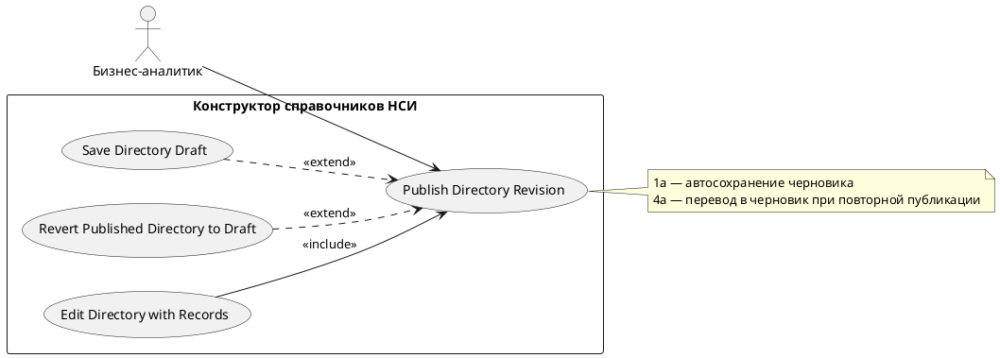

# USE CASE 07 | Publish Directory Revision

| Поле | Содержание |
|---|---|
| **USE CASE 07** | Publish Directory Revision |
| **Описание** | Бизнес-аналитик публикует ревизию справочника и ожидает, что справочник станет активным с новой ревизией, доступной для просмотра записям. |
| **Используется в** | N/A |
| **Предусловия** | Черновик справочника заполнен (паспорт + схема). У пользователя достаточно прав. |
| **Условие успешного завершения** | Справочник опубликован: создана новая ревизия с номером и датой. Справочник отображается в реестре как активный. Записи опубликованной ревизии доступны только для просмотра. |
| **Условие завершения с ошибкой** | Ревизия не опубликована. Справочник остался в состоянии черновика. Отображена причина (черновик не сохранён, нет прав, сбой сервера). |
| **Акторы** | Бизнес-аналитик (первичный). |
| **Стимул** | Пользователь нажимает «Опубликовать». |

## ОСНОВНОЙ ПОТОК (DESCRIPTION)

| Шаг | Действие |
|---|---|
| 1 | Бизнес-аналитик нажимает «Опубликовать». |
| 2 | Система проверяет, что черновик сохранён (при необходимости выполняет use case 06). |
| 3 | Система определяет ревизию для публикации. |
| 4 | Система публикует ревизию и переводит справочник в статус «активный». |
| 5 | Система нумерует опубликованную ревизию и фиксирует дату. |
| 6 | Система обновляет реестр НСИ и карточку справочника. |
| 7 | Система отображает опубликованную ревизию (RevisionBar) и блокирует изменение структуры на уровне записи. |

## РАСШИРЕНИЯ (EXTENSIONS)

| Шаг | Ветвление |
|---|---|
| 1a | Черновик не сохранён: 1a1. Система отображает «Сначала сохраните справочник» и выполняет use case 06 (Save Directory Draft). 1a2. Продолжить с шага 3. |
| 2a | Не удалось определить ревизию для редактирования/публикации: 2a1. Система отображает «Не удалось определить ревизию для редактирования». 2a2. Завершить сценарий. |
| 4a | Справочник уже опубликован и находится в статусе «опубликованный» при попытке повторной публикации без черновика: 4a1. Система отображает «Опубликованный справочник необходимо сначала перевести в черновик». 4a2. Продолжить use case 08 (Revert Published Directory to Draft), затем вернуться в use case 07 с шага 2. |

## ВАРИАЦИИ (VARIATIONS)

| Шаг | Вариант |
|---|---|
| 1 | Публикация может быть инициирована: · кнопкой «Опубликовать» в панели действий конструктора · из карточки справочника в реестре |

## СВЯЗИ С ДРУГИМИ USE CASE

- Расширяется: Save Directory Draft (use case 06) — условно, при несозданном черновике (расширение 1a).
- Включается в: Edit Directory with Records (use case 09, шаг 6) — публикация новой ревизии при редактировании.
- Вызывает: Revert Published Directory to Draft (use case 08) — при повторной публикации без черновика (расширение 4a).

## ДИАГРАММА USE CASE

Собственная диаграмма сценария: [`Диаграмма UC-07.png`](Диаграмма%20UC-07.png). Системная диаграмма — в файле «Диаграмма Use Case системы».

