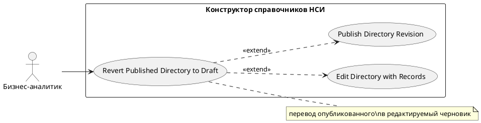

# USE CASE 08 | Revert Published Directory to Draft

| Поле | Содержание |
|---|---|
| **USE CASE 08** | Revert Published Directory to Draft |
| **Описание** | Бизнес-аналитик переводит опубликованный справочник в статус черновика и ожидает возможность редактирования его паспорта и структуры. |
| **Используется в** | N/A |
| **Предусловия** | Справочник имеет опубликованную ревизию (статус «активный»). У пользователя достаточно прав. |
| **Условие успешного завершения** | Справочник переведён в статус черновика: паспорт и структура доступны для редактирования, опубликованная ревизия сохранена в истории. |
| **Условие завершения с ошибкой** | Перевод не выполнен. Справочник остался опубликованным. Отображена причина (отсутствие прав, сбой). |
| **Акторы** | Бизнес-аналитик (первичный). |
| **Стимул** | Пользователь инициирует редактирование опубликованного справочника (кнопка «Редактировать» при статусе «опубликованный»). |

## ОСНОВНОЙ ПОТОК (DESCRIPTION)

| Шаг | Действие |
|---|---|
| 1 | Бизнес-аналитик инициирует перевод опубликованного справочника в черновик. |
| 2 | Система проверяет, что у пользователя достаточно прав. |
| 3 | Система копирует опубликованную ревизию в новую ревизию-черновик. |
| 4 | Система переводит справочник в статус черновика. |
| 5 | Система открывает конструктор для редактирования (паспорт + структура). |

## РАСШИРЕНИЯ (EXTENSIONS)

| Шаг | Ветвление |
|---|---|
| 2a | Недостаточно прав: 2a1. Система отображает «Недостаточно прав для выполнения операции». 2a2. Завершить сценарий. |
| 3a | Не удалось начать редактирование (конфликт ревизий): 3a1. Система отображает «Не удалось начать редактирование». 3a2. Завершить сценарий; справочник остался опубликованным. |

## ВАРИАЦИИ (VARIATIONS)

| Шаг | Вариант |
|---|---|
| 1 | Перевод может быть инициирован: · кнопкой «Редактировать» опубликованного справочника в реестре · автоматически при повторной публикации (use case 07, расширение 4a) |

## СВЯЗИ С ДРУГИМИ USE CASE

- Расширяет: Edit Directory with Records (use case 09) — условно, при редактировании опубликованного справочника (расширение 1a того UC).
- Расширяет: Publish Directory Revision (use case 07) — условно, при повторной публикации без черновика (расширение 4a того UC).

## ДИАГРАММА USE CASE

Собственная диаграмма сценария: [`Диаграмма UC-08.png`](Диаграмма%20UC-08.png). Системная диаграмма — в файле «Диаграмма Use Case системы».

