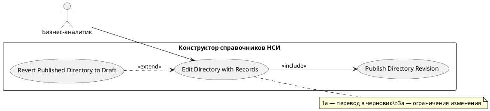

# USE CASE 09 | Edit Directory with Records

| Поле | Содержание |
|---|---|
| **USE CASE 09** | Edit Directory with Records |
| **Описание** | Бизнес-аналитик редактирует справочник, у которого уже есть записи (уточняет паспорт, расширяет структуру) и ожидает получить новую ревизию, совместимую с существующими записями. |
| **Используется в** | N/A |
| **Предусловия** | Справочник существует и содержит записи. У пользователя достаточно прав. |
| **Условие успешного завершения** | Изменения внесены (паспорт уточнён и/или структура расширена новыми элементами). При публикации создана новая ревизия; существующие записи сохраняются. |
| **Условие завершения с ошибкой** | Изменения не применены или не опубликованы. Справочник остался в прежнем состоянии. Отображена причина (попытка изменить код/наименование/тип/существующую структуру, нет прав). |
| **Акторы** | Бизнес-аналитик (первичный). |
| **Стимул** | Пользователь открывает редактирование справочника с записями. |

## ОСНОВНОЙ ПОТОК (DESCRIPTION)

| Шаг | Действие |
|---|---|
| 1 | Бизнес-аналитик открывает редактирование справочника с записями. |
| 2 | Система определяет ревизию для редактирования и открывает конструктор. |
| 3 | Система разрешает изменение паспорта в ограниченной схеме: уточнение полей без изменения наименования, типа, кода и существующей структуры; разрешено добавление новых элементов. |
| 4 | Пользователь вносит изменения в паспорт и/или добавляет новые поля схемы. |
| 5 | Система проверяет совместимость изменений со структурой записей. |
| 6 | Система публикует новую ревизию (use case 07). |
| 7 | Система отображает обновлённый справочник и его записи. |

## РАСШИРЕНИЯ (EXTENSIONS)

| Шаг | Ветвление |
|---|---|
| 1a | Справочник опубликован и не переведён в черновик: 1a1. Система выполняет use case 08 (Revert Published Directory to Draft). 1a2. Продолжить с шага 3. |
| 2a | Не удалось определить ревизию для редактирования: 2a1. Система отображает «Не удалось определить ревизию для редактирования». 2a2. Завершить сценарий. |
| 3a | Пользователь пытается изменить наименование, тип, код или существующую структуру: 3a1. Система блокирует изменение и отображает «Паспорт можно уточнить, но наименование, тип, код и существующую структуру менять нельзя. Можно только добавить новые элементы». 3a2. Продолжить с шага 4. |
| 5a | Изменения несовместимы с записями: 5a1. Система перечисляет несовместимые элементы. 5a2. Продолжить с шага 4. |

## ВАРИАЦИИ (VARIATIONS)

| Шаг | Вариант |
|---|---|
| 4 | Изменения могут касаться: · только паспорта (уточнение полей) · только схемы (добавление новых полей) · паспорта и схемы одновременно |

## СВЯЗИ С ДРУГИМИ USE CASE

- Включает: Publish Directory Revision (use case 07) — шаг 6.
- Расширяется: Revert Published Directory to Draft (use case 08) — условно, при опубликованном справочнике (расширение 1a).

## ДИАГРАММА USE CASE

Собственная диаграмма сценария: [`Диаграмма UC-09.png`](Диаграмма%20UC-09.png). Системная диаграмма — в файле «Диаграмма Use Case системы».

