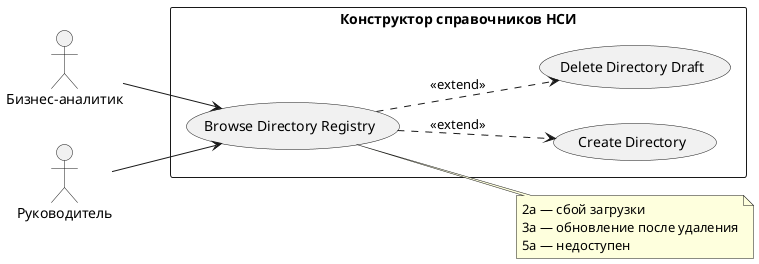

# USE CASE 10 | Browse Directory Registry

| Поле | Содержание |
|---|---|
| **USE CASE 10** | Browse Directory Registry |
| **Описание** | Пользователь просматривает реестр НСИ: список своих редактируемых (черновики) и справочников реестра с кодами, наименованиями, типами и датами действия, фильтрует по типу и выбирает действие над справочником. |
| **Используется в** | N/A |
| **Предусловия** | Пользователь вошёл в систему. Сервер доступен. |
| **Условие успешного завершения** | Реестр отобразил справочники, доступные пользователю: раздел «Редактируемые» и «Реестр справочников» со столбцами «Код», «Наименование», «Тип», «Дата начала», «Дата окончания», счётчиком «Всего: N». Пользователь выбрал действие над справочником. |
| **Условие завершения с ошибкой** | Реестр не загружен. Отображена причина («Не удалось загрузить справочники», «Нет связи с сервером»). Доступен повтор. |
| **Акторы** | Бизнес-аналитик (первичный — ищет свой справочник); Руководитель (вторичный — просматривает реестр организации). |
| **Стимул** | Пользователь открывает раздел «Реестр НСИ» (главная страница системы). |

## ОСНОВНОЙ ПОТОК (DESCRIPTION)

| Шаг | Действие |
|---|---|
| 1 | Пользователь открывает раздел «Реестр НСИ». |
| 2 | Система запрашивает у сервера список доступных пользователю справочников. |
| 3 | Система отображает реестр: раздел «Редактируемые» (свои черновики) и «Реестр справочников» со столбцами «Код», «Наименование», «Тип», «Дата начала», «Дата окончания», «Выбор действия». |
| 4 | Система отображает фильтр по типу («Все», «Пользовательский», «Технологический», «Защищенный (классификатор)»), счётчик «Всего: N» и пагинацию (записей на странице). |
| 5 | Пользователь выбирает справочник и действие. |
| 6 | Система выполняет выбранное действие (открытие в конструкторе или просмотре). |

## РАСШИРЕНИЯ (EXTENSIONS)

| Шаг | Ветвление |
|---|---|
| 2a | Загрузка справочников не удалась: 2a1. Система отображает «Не удалось загрузить справочники» с причиной (сервер недоступен/ошибка HTTP). 2a2. Завершить сценарий; доступен повтор. |
| 3a | Свой черновик отсутствует в разделе «Редактируемые» после удаления: 3a1. Система обновляет счётчик «Всего: N» и состав списка. 3a2. Продолжить с шага 4. |
| 5a | Справочник недоступен (изменены права): 5a1. Система отображает «Не удалось открыть справочник» / «Запрошенный ресурс не найден». 5a2. Продолжить с шага 5. |

## ВАРИАЦИИ (VARIATIONS)

| Шаг | Вариант |
|---|---|
| 4 | Фильтрация по типу справочника: · «Все» — без фильтра · «Пользовательский» · «Технологический» · «Защищенный (классификатор)» Все варианты приводят к одному результату — отфильтрованный список в тех же столбцах. |
| 5 | Пользователь может выбрать справочник: · из своих редактируемых (черновиков) · из активных справочников реестра · через фильтр по типу · на другой странице пагинации (например, 20 записей на странице) |
| 6 | Выбранный действие: · открыть черновик в конструкторе (редактирование) · открыть опубликованный справочник в режиме просмотра (read-only) |

## СВЯЗИ С ДРУГИМИ USE CASE

- Расширяет: Create Directory (use case 01) — условно, при проверке дубликата кода (расширение 1a того UC).
- Расширяет: Delete Directory Draft (use case 13) — условно, при наличии черновика в реестре (расширение 3a данного UC).

## ДИАГРАММА USE CASE

Собственная диаграмма сценария: [`Диаграмма UC-10.png`](Диаграмма%20UC-10.png). Системная диаграмма — в файле «Диаграмма Use Case системы».

