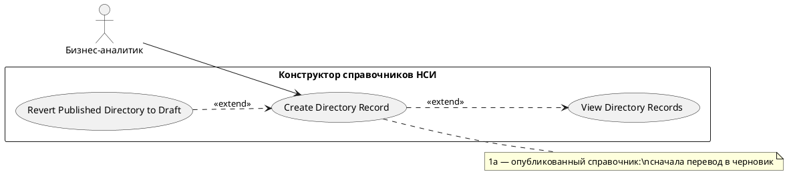

# USE CASE 11 | Create Directory Record

| Поле | Содержание |
|---|---|
| **USE CASE 11** | Create Directory Record |
| **Описание** | Бизнес-аналитик создаёт запись справочника по его схеме данных и ожидает, что запись сохранится в черновике/редактируемой ревизии справочника. |
| **Используется в** | N/A |
| **Предусловия** | Справочник существует и его структура определена. Справочник в редактируемом состоянии (черновик или переведён в черновик). У пользователя достаточно прав. |
| **Условие успешного завершения** | Запись создана с номером, значениями полей схемы и сохранена в редактируемой ревизии справочника. |
| **Условие завершения с ошибкой** | Запись не создана. Отображена причина (заполнены не все обязательные поля, справочник опубликован, нет прав). |
| **Акторы** | Бизнес-аналитик (первичный). |
| **Стимул** | Пользователь нажимает «Перейти к записям», затем «Новая запись». |

## ОСНОВНОЙ ПОТОК (DESCRIPTION)

| Шаг | Действие |
|---|---|
| 1 | Пользователь переходит к записям справочника. |
| 2 | Система открывает список записей и форму новой записи. |
| 3 | Пользователь заполняет значения полей схемы (включая вложенные объекты). |
| 4 | Система проверяет обязательность и типы значений полей. |
| 5 | Система присваивает записи порядковый номер. |
| 6 | Система сохраняет запись в редактируемой ревизии справочника. |
| 7 | Система отображает созданную запись в списке. |

## РАСШИРЕНИЯ (EXTENSIONS)

| Шаг | Ветвление |
|---|---|
| 1a | Справочник опубликован (записи доступны только для просмотра): 1a1. Система отображает «Записи опубликованной ревизии доступны только для просмотра». 1a2. Завершить сценарий; для создания записи выполняется use case 08 (перевод в черновик). |
| 4a | Обязательные поля не заполнены или значения не соответствуют типам: 4a1. Система выделяет некорректные поля и перечисляет причины. 4a2. Продолжить с шага 3. |

## ВАРИАЦИИ (VARIATIONS)

| Шаг | Вариант |
|---|---|
| 3 | Значения полей могут вводиться: · по одному полю в форме записи · через импорт набора записей |

## СВЯЗИ С ДРУГИМИ USE CASE

- Расширяется: View Directory Records (use case 12) — условно, при редактируемой ревизии (расширение 2a того UC).
- Расширяется: Revert Published Directory to Draft (use case 08) — условно, при опубликованном справочнике (расширение 1a данного UC).

## ДИАГРАММА USE CASE

Собственная диаграмма сценария: [`Диаграмма UC-11.png`](Диаграмма%20UC-11.png). Системная диаграмма — в файле «Диаграмма Use Case системы».

