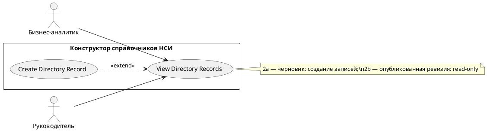

# USE CASE 12 | View Directory Records

| Поле | Содержание |
|---|---|
| **USE CASE 12** | View Directory Records |
| **Описание** | Пользователь просматривает записи справочника и ожидает увидеть список записей (в режиме редактирования или только для просмотра, в зависимости от статуса ревизии). |
| **Используется в** | N/A |
| **Предусловия** | Справочник существует. У пользователя доступ к его записям. |
| **Условие успешного завершения** | Список записей отображён с номерами и значениями полей. Режим (редактирование / только просмотр) соответствует статусу ревизии. |
| **Условие завершения с ошибкой** | Записи не загружены. Отображена причина («Не удалось открыть записи справочника», сбой сервера). |
| **Акторы** | Бизнес-аналитик (первичный); Руководитель (вторичный — просмотр). |
| **Стимул** | Пользователь нажимает «Перейти к записям» (или «Записи» в карточке справочника). |

## ОСНОВНОЙ ПОТОК (DESCRIPTION)

| Шаг | Действие |
|---|---|
| 1 | Пользователь нажимает «Перейти к записям». |
| 2 | Система определяет статус ревизии справочника (черновик / опубликованная). |
| 3 | Система запрашивает записи соответствующей ревизии. |
| 4 | Система отображает список записей (запись №, значения полей). |
| 5 | Система устанавливает режим: редактирование для черновика, только просмотр для опубликованной ревизии. |

## РАСШИРЕНИЯ (EXTENSIONS)

| Шаг | Ветвление |
|---|---|
| 2a | Ревизия редактируемая (черновик): 2a1. Система разрешает создание и изменение записей (use case 11). 2a2. Продолжить с шага 3. |
| 2b | Ревизия опубликованная: 2b1. Система ограничивает режим только просмотром («Записи опубликованной ревизии доступны только для просмотра»). 2b2. Продолжить с шага 3. |
| 3a | Записи не удалось открыть: 3a1. Система отображает «Не удалось открыть записи справочника». 3a2. Завершить сценарий. |

## ВАРИАЦИИ (VARIATIONS)

| Шаг | Вариант |
|---|---|
| 4 | Просмотр записей может быть: · таблицей по всем полям схемы · карточкой одной записи (пономерному) |

## СВЯЗИ С ДРУГИМИ USE CASE

- Расширяется: Create Directory Record (use case 11) — условно, при редактируемой ревизии (расширение 2a данного UC).

## ДИАГРАММА USE CASE

Собственная диаграмма сценария: [`Диаграмма UC-12.png`](Диаграмма%20UC-12.png). Системная диаграмма — в файле «Диаграмма Use Case системы».

