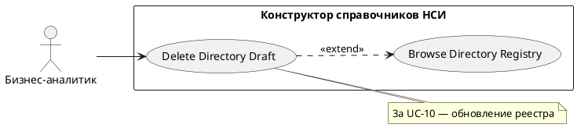

# USE CASE 13 | Delete Directory Draft

| Поле | Содержание |
|---|---|
| **USE CASE 13** | Delete Directory Draft |
| **Описание** | Бизнес-аналитик удаляет черновик своего справочника и ожидает, что черновик будет удалён из списка его справочников. |
| **Используется в** | N/A |
| **Предусловия** | Справочник находится в статусе черновика и принадлежит пользователю (или он имеет права на удаление). |
| **Условие успешного завершения** | Черновик удалён с сервера и исключён из списка «Мои справочники» (сообщение «Черновик удален»). |
| **Условие завершения с ошибкой** | Черновик не удалён. Список справочников не изменён. Отображена причина («Не удалось удалить черновик», нет прав, сбой сервера). |
| **Акторы** | Бизнес-аналитик (первичный). |
| **Стимул** | Пользователь нажимает «Удалить черновик» в карточке справочника. |

## ОСНОВНОЙ ПОТОК (DESCRIPTION)

| Шаг | Действие |
|---|---|
| 1 | Бизнес-аналитик нажимает «Удалить черновик». |
| 2 | Система запрашивает подтверждение удаления («Черновик будет удален из списка моих справочников»). |
| 3 | Пользователь подтверждает удаление. |
| 4 | Система удаляет черновик с сервера. |
| 5 | Система обновляет реестр: черновик исключён из «Мои справочники» (use case 10, расширение 3a). |
| 6 | Система отображает «Черновик удален». |

## РАСШИРЕНИЯ (EXTENSIONS)

| Шаг | Ветвление |
|---|---|
| 2a | Пользователь отменил удаление: 2a1. Система возвращает в список справочников. 2a2. Завершить сценарий; черновик сохранён. |
| 4a | Удаление не удалось: 4a1. Система отображает «Не удалось удалить черновик» с причиной. 4a2. Завершить сценарий. |

## ВАРИАЦИИ (VARIATIONS)

| Шаг | Вариант |
|---|---|
| 1 | Удаление может быть инициировано: · кнопкой «Удалить черновик» в карточке справочника · из списка редактируемых справочников в реестре |

## СВЯЗИ С ДРУГИМИ USE CASE

- Расширяется: Browse Directory Registry (use case 10) — условно, при наличии черновика в реестре (расширение 3a того UC).

## ДИАГРАММА USE CASE

Собственная диаграмма сценария: [`Диаграмма UC-13.png`](Диаграмма%20UC-13.png). Системная диаграмма — в файле «Диаграмма Use Case системы».

