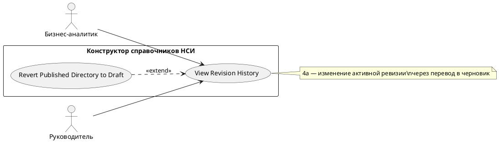

# USE CASE 14 | View Revision History

| Поле | Содержание |
|---|---|
| **USE CASE 14** | View Revision History |
| **Описание** | Пользователь просматривает историю ревизий справочника (кто добавил/изменил/удалил, номер ревизии, статус) и ожидает увидеть полную хронологию изменений. |
| **Используется в** | N/A |
| **Предусловия** | Справочник существует и имеет хотя бы одну ревизию. У пользователя доступ. |
| **Условие успешного завершения** | История ревизий отображена: номера ревизий, статусы (черновик/активная), действия (Добавил/Изменил/Удалил), исполнители, даты. |
| **Условие завершения с ошибкой** | История не загружена. Отображена причина (справочник не найден, сбой сервера). |
| **Акторы** | Бизнес-аналитик (первичный); Руководитель (вторичный — контроль изменений). |
| **Стимул** | Пользователь открывает историю ревизий (RevisionBar / «Ревизия» в карточке справочника). |

## ОСНОВНОЙ ПОТОК (DESCRIPTION)

| Шаг | Действие |
|---|---|
| 1 | Пользователь открывает историю ревизий справочника. |
| 2 | Система запрашивает у сервера список ревизий справочника. |
| 3 | Система отображает ревизии с номерами, статусами и действиями (Добавил/Изменил/Удалил). |
| 4 | Пользователь выбирает ревизию для просмотра. |
| 5 | Система отображает выбранную ревизию (паспорт и/или структуру на дату ревизии). |

## РАСШИРЕНИЯ (EXTENSIONS)

| Шаг | Ветвление |
|---|---|
| 2a | История ревизий не загрузилась: 2a1. Система отображает причину (ошибка HTTP, сервер недоступен). 2a2. Завершить сценарий; доступен повтор. |
| 4a | Выбранная ревизия — текущая активная опубликованная, и пользователь хочет её изменить: 4a1. Система выполняет use case 08 (Revert Published Directory to Draft) для перехода к редактированию. 4a2. Продолжить с шага 5 после перевода. |

## ВАРИАЦИИ (VARIATIONS)

| Шаг | Вариант |
|---|---|
| 4 | Пользователь может выбрать ревизию: · по номеру в списке · переключателем ревизий (RevisionBar) |

## СВЯЗИ С ДРУГИМИ USE CASE

- Расширяется: Revert Published Directory to Draft (use case 08) — условно, при попытке изменить активную опубликованную ревизию (расширение 4a данного UC).

## ДИАГРАММА USE CASE

Собственная диаграмма сценария: [`Диаграмма UC-14.png`](Диаграмма%20UC-14.png). Системная диаграмма — в файле «Диаграмма Use Case системы».

