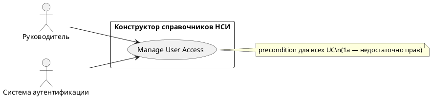

# USE CASE 15 | Manage User Access

| Поле | Содержание |
|---|---|
| **USE CASE 15** | Manage User Access |
| **Описание** | Руководитель управляет ролевым доступом пользователей организации к справочникам (роли Бизнес-аналитик/Руководитель, организация) и ожидает, что права будут применены ко всем операциям конструктора. |
| **Используется в** | N/A |
| **Предусловия** | Пользователь вошёл в систему под ролью Руководитель. Доступны пользователи организации. |
| **Условие успешного завершения** | Права (роль, организация) назначены/изменены для выбранных пользователей. Ограничения доступа применены: пользователь видит только разрешённые справочники и операции; для «Защищенного (классификатора)» — только пользователи организации. |
| **Условие завершения с ошибкой** | Права не изменены. Отображена причина (нет прав у текущего пользователя, сбой сервера). |
| **Акторы** | Руководитель (первичный). Система аутентификации (вторичная — проверка прав). |
| **Стимул** | Руководитель открывает управление доступом и назначает/изменяет роли. |

## ОСНОВНОЙ ПОТОК (DESCRIPTION)

| Шаг | Действие |
|---|---|
| 1 | Руководитель открывает управление ролевым доступом. |
| 2 | Система отображает пользователей организации с текущими ролями. |
| 3 | Руководитель выбирает пользователя и задаёт роль (Бизнес-аналитик / Руководитель). |
| 4 | Система проверяет, что у текущего пользователя достаточно прав на изменение доступа. |
| 5 | Система применяет изменения прав на сервере. |
| 6 | Система подтверждает назначение и обновляет список пользователей. |

## РАСШИРЕНИЯ (EXTENSIONS)

| Шаг | Ветвление |
|---|---|
| 1a | Пользователь (в любом сценарии системы) не имеет достаточных прав на операцию: 1a1. Система отображает «Недостаточно прав для выполнения операции». 1a2. Завершить сценарий. |
| 4a | Текущий пользователь не имеет прав на управление доступом: 4a1. Система отображает «Недостаточно прав для выполнения операции». 4a2. Завершить сценарий. |
| 5a | Сессия истекла при применении изменений: 5a1. Система отображает «Сессия истекла, войдите заново». 5a2. Завершить сценарий; пользователь входит повторно. |

## ВАРИАЦИИ (VARIATIONS)

| Шаг | Вариант |
|---|---|
| 3 | Роль может быть: · Бизнес-аналитик (создание/редактирование своих справочников) · Руководитель (управление доступом, контроль ревизий) |

## СВЯЗИ С ДРУГИМИ USE CASE

- Является предрасположением (precondition) для всех UC системы: при недостатке прав операция блокируется (расширение 1a любого сценария).

## ДИАГРАММА USE CASE

Собственная диаграмма сценария: [`Диаграмма UC-15.png`](Диаграмма%20UC-15.png). Системная диаграмма — в файле «Диаграмма Use Case системы».

