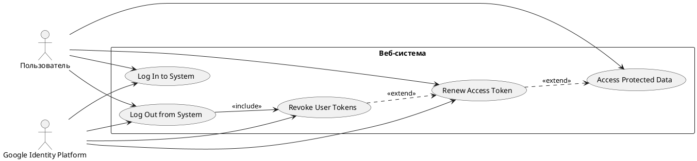

# Диаграмма Use Case системы — подсистема входа (OAuth 2.1)

Отрисованная диаграмма: [`Диаграмма Use Case системы.png`](Диаграмма%20Use%20Case%20системы.png)

## Элементы

**Акторы (2):**
- **Пользователь** — человек, инициирует вход, доступ к данным, выход; владелец целей UC-01…UC-04 и UC-05.
- **Google Identity Platform** — внешний сервис авторизации (OIDC-провайдер): выдаёт code/токены, отзывает refresh-токен, завершает сессию у себя.

**Прецеденты (5):**

| UC | Название | Акторы | Роль в системе |
|---|---|---|---|
| UC-01 | Log In to System | Пользователь, Google Identity Platform | Полный вход: от нажатия «Войти» до авторизованной сессии |
| UC-02 | Access Protected Data | Пользователь | Доступ к персональным данным по сессии и access-токену |
| UC-03 | Renew Access Token | Пользователь, Google Identity Platform | Тихое продление access-токена по refresh-токену (ротация) |
| UC-04 | Log Out from System | Пользователь, Google Identity Platform | Полный выход: отзыв + завершение сессии у провайдера + локальная сессия |
| UC-05 | Revoke User Tokens | Google Identity Platform (сервис), Пользователь (цель) | Отзыв refresh-токена; вызывается UC-04 и UC-03 |

## Связи

**Ассоциации (сплошные линии):**
- Пользователь ↔ UC-01, UC-02, UC-03, UC-04
- Google Identity Platform ↔ UC-01, UC-03, UC-04, UC-05

**Включение (пунктирная стрелка `<<include>>`, стрелка к включаемому):**
- Log Out from System (UC-04) --> Revoke User Tokens (UC-05): отзыв refresh-токена обязателен для выхода (шаг 2).

**Расширения (пунктирная стрелка `<<extend>>`, стрелка к базовому UC):**
- Revoke User Tokens (UC-05) ..> Renew Access Token (UC-03): при сбоях продления (3b, 4a, 5a, 6a) к UC-03 условно присоединяется отзыв токенов.
- Renew Access Token (UC-03) ..> Access Protected Data (UC-02): при просроченном access-токене (3a) к UC-02 условно присоединяется тихое продление.

Вложенность расширений: 2 уровня (UC-02 → UC-03 → UC-05) — на пределе нормы, не более.

## PlantUML-источник

## Проверка диаграммы
- Каждый актор связан с ≥ 1 прецедентом ✓.
- Граница соответствует области системы (веб-приложение + бэкенд) ✓.
- Направления стрелок: `<<include>>` — к включаемому (UC-05), `<<extend>>` — к базовому (UC-03, UC-02) ✓.
- 5 прецедентов — в пределах лимита 12–15 ✓.
- Вложенность include/extend ≤ 2 ✓.

## Матрица трассировки UC ↔ UC

| Откуда | Куда | Тип связи | Точка срабатывания |
|---|---|---|---|
| UC-02 | UC-03 | extend | UC-02/3a — access-токен просрочен |
| UC-03 | UC-05 | extend | UC-03/3b, 4a, 5a, 6a — сбой продления |
| UC-04 | UC-05 | include | UC-04, шаг 2 — отзыв обязателен |
| UC-02 | UC-01 | вызов (переход) | UC-02/2a, 4a — сессия/токен недействительны |
| UC-03 | UC-01 | вызов (переход) | UC-03/3b, 4a, 5a, 6a — повторный вход |
