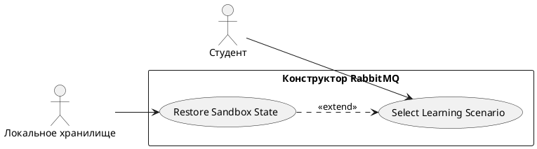

# USE CASE 01 | Select Learning Scenario

| Поле | Содержание |
|---|---|
| **USE CASE 01** | Select Learning Scenario |
| **Описание** | Студент выбирает учебный сценарий (direct, fanout, topic, DLQ, retry, headers) или свободный режим и ожидает загрузку готовой топологии с задачей и критериями проверки. |
| **Используется в** | N/A |
| **Предусловия** | Симулятор открыт в браузере и загружен. Сценарии (6 учебной + 1 свободная) определены. |
| **Условие успешного завершения** | На холсте отрисована топология выбранного сценария (exchanges, очереди, bindings, producers, consumers). Задача сценария и список проверок отображены. Метрики обнулены (published, routed, ready, unacked, acked, dead-letter, dropped = 0). |
| **Условие завершения с ошибкой** | Топология не загружена. Предыдущее состояние холста сохранено. Метрики не изменены. |
| **Акторы** | Студент (первичный — выбирает сценарий). Локальное хранилище браузера (вторичный — источник сохранённого состояния). |
| **Стимул** | Студент выбирает сценарий в списке сценариев или нажимает на карточку топологии. |

## ОСНОВНОЙ ПОТОК (DESCRIPTION)

| Шаг | Действие |
|---|---|
| 1 | Студент выбирает сценарий: учебный (direct, fanout, topic, DLQ, retry, headers) или свободный режим. |
| 2 | Система запрашивает сохранённое состояние выбранного сценария у локального хранилища браузера. |
| 3 | Система очищает холст и загружает топологию сценария: exchanges, очереди, bindings, producers, consumers. |
| 4 | Система отображает задачу сценария, подсказку и список проверок с прогрессом «0 из N». |
| 5 | Система обнуляет метрики (published, routed, ready, unacked, acked, dead-letter, dropped) и очищает журнал событий. |
| 6 | Система отрисовывает узлы и связи топологии на холсте. |

## РАСШИРЕНИЯ (EXTENSIONS)

| Шаг | Ветвление |
|---|---|
| 1a | Сохранённое состояние выбранного сценария найдено: 1a1. Система предлагает студенту восстановить сохранённое состояние или начать заново. 1a2. Студент выбирает один из вариантов. 1a3. При выборе «восстановить» — выполнить use case 06 (Restore Sandbox State) и завершить текущий сценарий; при выборе «заново» — продолжить с шага 3. |

## ВАРИАЦИИ (VARIATIONS)

| Шаг | Вариант |
|---|---|
| 1 | Студент может выбрать: · учебный сценарий 01 — direct (доставка по ключу) · учебный сценарий 02 — fanout (вещание всем) · учебный сценарий 03 — topic (маски и ключи) · учебный сценарий 04 — DLQ (mёртвые письма) · учебный сценарий 05 — retry / TTL (отложенная повторная доставка) · учебный сценарий 06 — headers (маршрутизация по атрибутам) · свободный режим (sandbox — полный конструктор) |

## СВЯЗИ С ДРУГИМИ USE CASE

- Расширяется: Restore Sandbox State (use case 06) — условно, при наличии сохранённого состояния (расширение 1a).
- Вызывает: Restore Sandbox State (use case 06) — при подтверждении восстановления (1a3).

## ДИАГРАММА USE CASE

Собственная диаграмма сценария: [`Диаграмма UC-01.png`](Диаграмма%20UC-01.png). Системная диаграмма всех сценариев — в файле «Диаграмма Use Case системы».

