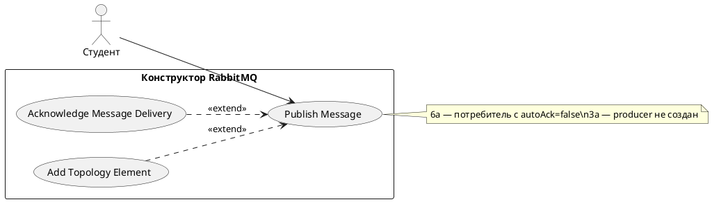

# USE CASE 02 | Publish Message

| Поле | Содержание |
|---|---|
| **USE CASE 02** | Publish Message |
| **Описание** | Студент публикует сообщение в exchange с заданным routing key (и/или headers) и ожидает увидеть его маршрутизацию по топологии и доставку в целевые очереди. |
| **Используется в** | N/A |
| **Предусловия** | Топология загружена (use case 01). Exchange и биндинги определены. Producer выбран или существует. |
| **Условие успешного завершения** | Сообщение опубликовано и подтверждено (publisher confirm). Все очереди, чей binding совпал с routing key / headers, получили копию сообщения. Метрики published и routed увеличены. Записи доставки отображены в маршруте и журнале. |
| **Условие завершения с ошибкой** | Сообщение не опубликовано или опубликовано, но не доставлено ни в одну очередь (unroutable). Состояние очередей не изменено. Метрика unroutable/dropped увеличена, о причинах отображено в журнале. |
| **Акторы** | Студент (первичный — задаёт сообщение и инициирует публикацию). Симулятор (вторичный — выполняет routing и доставку). |
| **Стимул** | Студент нажимает «Опубликовать» (или Ctrl+Enter) в панели публикации. |

## ОСНОВНОЙ ПОТОК (DESCRIPTION)

| Шаг | Действие |
|---|---|
| 1 | Студент задаёт routing key, payload, headers, count сообщения в панели публикации. |
| 2 | Студент нажимает «Опубликовать». |
| 3 | Система отбрасывает (publish) сообщение в выбранный exchange от имени selected producer. |
| 4 | Система обрабатывает publisher confirm: сообщение помечено confirmed. |
| 5 | Система сравнивает routing key (для direct/topic) или headers (для headers) с биндингами exchange. |
| 6 | Система копирует сообщение во все совпавшие очереди; доставка помечена routed. |
| 7 | Система увеличивает метрики published, routed и (для очередей без consumers) ready. |
| 8 | Система отображает сообщение в списке доставок и в журнале событий. |

## РАСШИРЕНИЯ (EXTENSIONS)

| Шаг | Ветвление |
|---|---|
| 5a | Ни один binding exchange не совпал с routing key / headers (unroutable): 5a1. Система помечает сообщение unroutable; метрика unroutable увеличена. 5a2. Система отображает причину в журнале («сообщение не доставлено ни в одну очередь»). 5a3. Завершить сценарий. |
| 6a | В целевой очереди есть consumer с autoAck=false: 6a1. Система доставляет сообщение потребителю; доставка помечена unacked. 6a2. Метрики unacked увеличена, ready не увеличивается. 6a3. Продолжить use case 03 (Acknowledge Message Delivery) для подтверждения/отклонения. |
| 3a | Producer не выбран (свободный режим, producers не определены): 3a1. Система предлагает студенту выбрать producer или создать новый (use case 04). 3a2. При создании — продолжить с шага 3; при выборе — продолжить с шага 3. |

## ВАРИАЦИИ (VARIATIONS)

| Шаг | Вариант |
|---|---|
| 1 | Студент может указать сообщение одним из способов: · предзаполненный шаблон сценария (routing key + payload + headers по умолчанию) · собственный routing key и payload в текстовых полях · несколько сообщений подряд (count > 1) · с указанием persistence (delivery mode) и priority |

## СВЯЗИ С ДРУГИМИ USE CASE

- Расширяется: Acknowledge Message Delivery (use case 03) — условно, при потребителе с autoAck=false (расширение 6a).
- Вызывает: Add Topology Element (use case 04) — при отсутствии producer (расширение 3a).

## ДИАГРАММА USE CASE

Собственная диаграмма сценария: [`Диаграмма UC-02.png`](Диаграмма%20UC-02.png). Системная диаграмма всех сценариев — в файле «Диаграмма Use Case системы».

