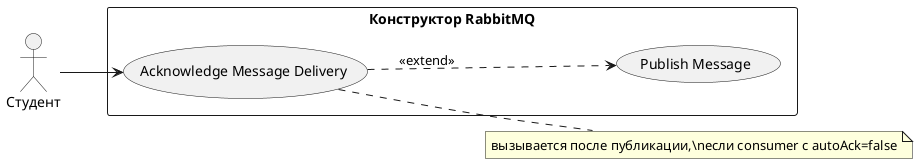

# USE CASE 03 | Acknowledge Message Delivery

| Поле | Содержание |
|---|---|
| **USE CASE 03** | Acknowledge Message Delivery |
| **Описание** | Студент подтверждает (ack) или отклоняет (nack/reject) доставку сообщения активному потребителю и ожидает, что сообщение будет удалено из очереди или перенаправлено по правилам очереди (DLX/retry). |
| **Используется в** | N/A |
| **Предусловия** | Очередь имеет активного consumer с autoAck=false. В очереди есть недоставленное (unacked) или готовое (ready) сообщение. |
| **Условие успешного завершения** | При ack: сообщение удалено из очереди, метрики ready/unacked уменьшены, acked увеличена. При nack с requeue: сообщение возвращено в очередь с меткой redelivered. При nack без requeue (или reject): сообщение перенаправлено в dead-letter exchange очереди (DLX) и доставлено в DLQ, либо удалено при отсутствии DLX. |
| **Условие завершения с ошибкой** | Операция не выполнена. Сообщение осталось в прежнем состоянии (unacked/ready). Метрики не изменены. |
| **Акторы** | Студент (первичный — инициирует ack/nack). Потребитель (consumer, вторичный — роль доставки и подтверждения). |
| **Стимул** | Студент нажимает ack, nack или reject на сообщении в инспекторе очереди. |

## ОСНОВНОЙ ПОТОК (DESCRIPTION)

| Шаг | Действие |
|---|---|
| 1 | Студент выбирает сообщение в инспекторе очереди. |
| 2 | Студент нажимает ack (подтвердить) или nack (отклонить). |
| 3 | Система обрабатывает ack: удаляет сообщение из очереди. |
| 4 | Система уменьшает метрики ready или unacked и увеличивает метрику acked. |
| 5 | Система записывает результат подтверждения в журнал событий. |

## РАСШИРЕНИЯ (EXTENSIONS)

| Шаг | Ветвление |
|---|---|
| 2a | Студент нажал nack (отклонить): 2a1. Система определяет параметры requeue (повторная доставка) для операции. 2a2. При requeue=true — вернуть сообщение в очередь с меткой redelivered, продолжить с шага 4. 2a3. При requeue=false — перейти к 2a4. 2a4. Система передаёт сообщение в dead-letter exchange очереди (если он задан). 2a5. Система доставляет сообщение в DLQ (очередь, связанную с DLX) или удаляет его при отсутствии DLX; метрика dead-letter увеличена. 2a6. Продолжить с шага 4. |
| 3a | У очереди нет active consumer или consumer остановлен: 3a1. Система сообщает студенту, что подтверждение невозможно. 3a2. Завершить сценарий. |

## ВАРИАЦИИ (VARIATIONS)

| Шаг | Вариант |
|---|---|
| 2 | Студент может отклонить сообщение: · nack с requeue=true (повторная доставка) · nack с requeue=false (dead-letter) · reject (dead-letter, без requeue) |

## СВЯЗИ С ДРУГИМИ USE CASE

- Расширяется: Publish Message (use case 02) — условно, при потребителе с autoAck=false (расширение 6a того UC).
- Сам по себе не включает и не вызывает другие UC.

## ДИАГРАММА USE CASE

Собственная диаграмма сценария: [`Диаграмма UC-03.png`](Диаграмма%20UC-03.png). Системная диаграмма всех сценариев — в файле «Диаграмма Use Case системы».

