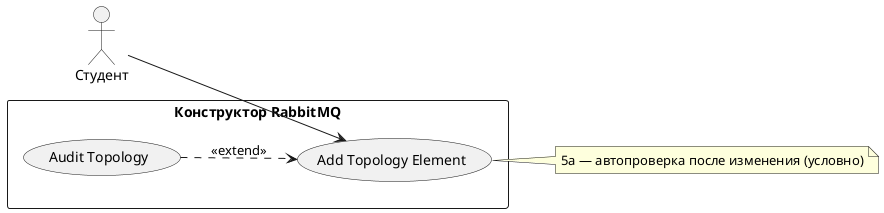

# USE CASE 04 | Add Topology Element

| Поле | Содержание |
|---|---|
| **USE CASE 04** | Add Topology Element |
| **Описание** | Студент добавляет узел топологии (producer, exchange, очередь, binding, consumer) в свободном режиме и ожидает, что узел появится на холсте с заданными параметрами. |
| **Используется в** | N/A |
| **Предусловия** | Открыт холст с топологией (свободный режим или учебный сценарий). Инструмент добавления доступен. |
| **Условие успешного завершения** | Узел отображён на холсте. Параметры узла (имя, тип, аргументы) заданы. При добавлении binding — связь между exchange и очередью отображена. |
| **Условие завершения с ошибкой** | Узел не добавлен. Топология не изменена. Отображена причина ошибки (дублирующееся имя, конфликт типа). |
| **Акторы** | Студент (первичный). |
| **Стимул** | Студент запускает действие добавления узла (панель инструментов, контекстное меню, drag с палитры). |

## ОСНОВНОЙ ПОТОК (DESCRIPTION)

| Шаг | Действие |
|---|---|
| 1 | Студент выбирает тип узла: producer, exchange, очередь, binding, consumer. |
| 2 | Система отображает форму параметров узла. |
| 3 | Студент задаёт параметры узла (имя, тип exchange, аргументы очереди, exchange/queue и key/args для binding, autoAck/prefetch для consumer). |
| 4 | Система проверяет корректность параметров. |
| 5 | Система добавляет узел в модель топологии. |
| 6 | Система отрисовывает узел на холсте. |
| 7 | Система сохраняет изменение в историю (undo/redo). |

## РАСШИРЕНИЯ (EXTENSIONS)

| Шаг | Ветвление |
|---|---|
| 4a | Имя узла дублируется или тип несовместим с контекстом (например, consumer на exchange): 4a1. Система отображает причину ошибки. 4a2. Завершить сценарий; студент может изменить параметры и повторить с шага 3. |
| 5a | Узел добавлен, и студент включил автопроверку схемы: 5a1. Запустить use case 05 (Audit Topology). 5a2. Продолжить с шага 6. |

## ВАРИАЦИИ (VARIATIONS)

| Шаг | Вариант |
|---|---|
| 1 | Студент может добавить узел: · кнопкой на панели инструментов · перетаскиванием из палитры узлов · через форму инспектора · через импорт topology.json (bulk — несколько узлов за раз) |

## СВЯЗИ С ДРУГИМИ USE CASE

- Вызывает: Audit Topology (use case 05) — условно, при автопроверке (расширение 5a).
- Вызывается: Publish Message (use case 02, расширение 3a) — при отсутствии producer.

## ДИАГРАММА USE CASE

Собственная диаграмма сценария: [`Диаграмма UC-04.png`](Диаграмма%20UC-04.png). Системная диаграмма всех сценариев — в файле «Диаграмма Use Case системы».

