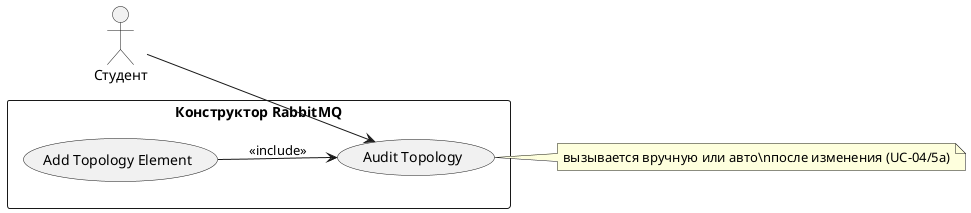

# USE CASE 05 | Audit Topology

| Поле | Содержание |
|---|---|
| **USE CASE 05** | Audit Topology |
| **Описание** | Студент запускает аудит текущей топологии и ожидает получить отчёт о проблемах схемы (орфанные очереди, неиспользуемые bindings, отсутствие consumers, настройки DLX) с оценкой (score). |
| **Используется в** | N/A |
| **Предусловия** | На холсте определена топология хотя бы с одним узлом. |
| **Условие успешного завершения** | Отчёт аудита сформирован: список проблем (severity: critical/warning) по узлам и связям, итоговая оценка схемы (score). |
| **Условие завершения с ошибкой** | Отчёт не сформирован. Топология не изменена. Отображена причина сбоя (пустая топология). |
| **Акторы** | Студент (первичный). |
| **Стимул** | Студент нажимает «Аудит схемы» (или автозапуск после изменения — use case 04, расширение 5a). |

## ОСНОВНОЙ ПОТОК (DESCRIPTION)

| Шаг | Действие |
|---|---|
| 1 | Студент запускает аудит текущей топологии. |
| 2 | Система проходит по всем узлам и связям топологии. |
| 3 | Система проверяет каждый узел и binding на правила корректности схемы (орфанные очереди, неиспользуемые bindings, очереди без consumer, DLX без DLQ, тип exchange). |
| 4 | Система формирует список проблем с уровнем severity и рекомендациями. |
| 5 | Система рассчитывает итоговую оценку (score) схемы. |
| 6 | Система отображает отчёт аудита студенту. |

## РАСШИРЕНИЯ (EXTENSIONS)

| Шаг | Ветвление |
|---|---|
| 2a | Топология пуста (нет узлов): 2a1. Система отображает «схема пуста — добавить узлы». 2a2. Завершить сценарий. |

## ВАРИАЦИИ (VARIATIONS)

| Шаг | Вариант |
|---|---|
| 1 | Аудит может быть запущен: · вручную (кнопка «Аудит схемы») · автоматически после добавления/изменения узла (use case 04, расширение 5a) |

## СВЯЗИ С ДРУГИМИ USE CASE

- Включается в: Add Topology Element (use case 04, расширение 5a) — условно, при автопроверке.
- Сам по себе не вызывает другие UC.

## ДИАГРАММА USE CASE

Собственная диаграмма сценария: [`Диаграмма UC-05.png`](Диаграмма%20UC-05.png). Системная диаграмма всех сценариев — в файле «Диаграмма Use Case системы».

