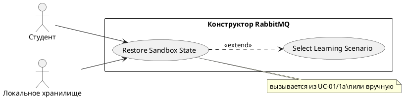

# USE CASE 06 | Restore Sandbox State

| Поле | Содержание |
|---|---|
| **USE CASE 06** | Restore Sandbox State |
| **Описание** | Студент восстанавливает сохранённое состояние песочницы (топологию, сообщения, метрики, журнал) и ожидает продолжить работу с того места, где остановился. |
| **Используется в** | N/A |
| **Предусловия** | В локальном хранилище браузера есть сохранённое состояние для текущего сценария/режима (выполнялся use case 07). |
| **Условие успешного завершения** | Холст загружен из сохранённого состояния: узлы, bindings, сообщения в очередях, метрики и журнал восстановлены. Студент продолжает работу с восстановленной топологией. |
| **Условие завершения с ошибкой** | Состояние не восстановлено. На холсте остаётся текущая (начальная) топология. Отображена причина (состояние повреждено). |
| **Акторы** | Студент (первичный — подтверждает восстановление). Локальное хранилище браузера (вторичный — источник состояния). |
| **Стимул** | Студент подтверждает восстановление состояния (из use case 01, расширение 1a) или нажимает «Восстановить» вручную. |

## ОСНОВНОЙ ПОТОК (DESCRIPTION)

| Шаг | Действие |
|---|---|
| 1 | Студент подтверждает восстановление сохранённого состояния. |
| 2 | Система запрашивает состояние сценария у локального хранилища браузера. |
| 3 | Система проверяет целостность сохранённого состояния. |
| 4 | Система загружает в модель топологию, consumers, сообщения, метрики, журнал из сохранённого состояния. |
| 5 | Система отрисовывает восстановленную топологию и данные на холсте. |

## РАСШИРЕНИЯ (EXTENSIONS)

| Шаг | Ветвление |
|---|---|
| 2a | Сохранённое состояние не найдено: 2a1. Система сообщает студенту об отсутствии сохранений. 2a2. Продолжить use case 01 (Select Learning Scenario) — загрузка начальной топологии сценария. |
| 3a | Состояние повреждено (не удалось прочитать): 3a1. Система сообщает о повреждении состояния. 3a2. Завершить сценарий; студент может повторить с шага 1 или начать сценарий заново. |

## ВАРИАЦИИ (VARIATIONS)

| Шаг | Вариант |
|---|---|
| 1 | Восстановление может быть инициировано: · автоматически при выборе сценария с сохранением (use case 01, расширение 1a) · кнопкой «Восстановить» в панели управления |

## СВЯЗИ С ДРУГИМИ USE CASE

- Является расширением: Select Learning Scenario (use case 01) — условно, при наличии сохранённого состояния (расширение 1a того UC).
- Вызывает: Select Learning Scenario (use case 01) — при отсутствии сохранений (расширение 2a).

## ДИАГРАММА USE CASE

Собственная диаграмма сценария: [`Диаграмма UC-06.png`](Диаграмма%20UC-06.png). Системная диаграмма всех сценариев — в файле «Диаграмма Use Case системы».

