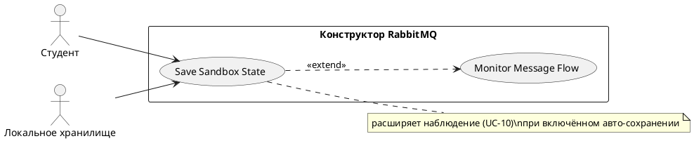

# USE CASE 07 | Save Sandbox State

| Поле | Содержание |
|---|---|
| **USE CASE 07** | Save Sandbox State |
| **Описание** | Студент сохраняет текущее состояние песочницы и ожидает, что при следующем открытии сценария состояние будет доступно для восстановления. |
| **Используется в** | N/A |
| **Предусловия** | В песочнице открыта топология с состоянием (узлы, сообщения, метрики, журнал). |
| **Условие успешного завершения** | Состояние (топология, consumers, сообщения, метрики, журнал, позиция холста) записано в локальное хранилище браузера под ключом текущего сценария. |
| **Условие завершения с ошибкой** | Состояние не сохранено. Прежнее сохранение (если было) осталось без изменений. Отображена причина (хранилище недоступно/переполнено). |
| **Акторы** | Студент (первичный — инициирует сохранение, либо авто-сохранение по событию). Локальное хранилище браузера (вторичный — цель записи). |
| **Стимул** | Студент нажимает «Сохранить» либо происходит событие, запускающее авто-сохранение (пауза симуляции, закрытие вкладки). |

## ОСНОВНОЙ ПОТОК (DESCRIPTION)

| Шаг | Действие |
|---|---|
| 1 | Студент инициирует сохранение (кнопка) либо срабатывает авто-сохранение. |
| 2 | Система собирает текущее состояние: топология, consumers, сообщения в очередях, метрики, журнал, позиция холста. |
| 3 | Система сериализует состояние. |
| 4 | Система записывает состояние в локальное хранилище браузера под ключом сценария. |
| 5 | Система подтверждает сохранение студенту (индикатор). |

## РАСШИРЕНИЯ (EXTENSIONS)

| Шаг | Ветвление |
|---|---|
| 4a | Локальное хранилище недоступно или переполнено (квота браузера): 4a1. Система отображает причину сбоя сохранения. 4a2. Завершить сценарий; текущее состояние в памяти сессии сохраняется до её закрытия. |
| 1a | Сценарий уже имеет сохранённое состояние: 1a1. Система перекрывает прежнее сохранение новым (последнее состояние — актуальное). 1a2. Продолжить с шага 2. |

## ВАРИАЦИИ (VARIATIONS)

| Шаг | Вариант |
|---|---|
| 1 | Сохранение может быть инициировано: · вручную (кнопка «Сохранить») · автоматически при паузе симуляции · автоматически при закрытии/сворачивании вкладки |

## СВЯЗИ С ДРУГИМИ USE CASE

- Расширяет: Monitor Message Flow (use case 10) — условно, при включённом авто-сохранении (шаг 1 того UC).
- Является условием для: Restore Sandbox State (use case 06) — сохранение должно существовать.

## ДИАГРАММА USE CASE

Собственная диаграмма сценария: [`Диаграмма UC-07.png`](Диаграмма%20UC-07.png). Системная диаграмма всех сценариев — в файле «Диаграмма Use Case системы».

