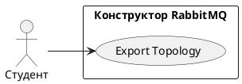

# USE CASE 08 | Export Topology

| Поле | Содержание |
|---|---|
| **USE CASE 08** | Export Topology |
| **Описание** | Студент выгружает текущую топологию в артефакт (definitions.json, project.json, topology.json, markdown, стартовый пакет) и ожидает получить файл для использования во внешнем окружении RabbitMQ. |
| **Используется в** | N/A |
| **Предусловия** | На холсте определена непустая топология. |
| **Условие успешного завершения** | Артефакт сформирован и загружен в браузер (файл сохранён студентом). Файл соответствует выбранному формату. |
| **Условие завершения с ошибкой** | Артефакт не сформирован. Отображена причина (топология пуста, формат не поддерживает текущую схему). |
| **Акторы** | Студент (первичный). |
| **Стимул** | Студент выбирает «Экспорт» и формат артефакта. |

## ОСНОВНОЙ ПОТОК (DESCRIPTION)

| Шаг | Действие |
|---|---|
| 1 | Студент выбирает «Экспорт». |
| 2 | Студент выбирает формат артефакта (definitions.json, project.json, topology.json, markdown, стартовый пакет). |
| 3 | Система формирует содержимое артефакта по модели топологии. |
| 4 | Система предлагает студенту скачать файл. |
| 5 | Студент сохраняет файл. |

## РАСШИРЕНИЯ (EXTENSIONS)

| Шаг | Ветвление |
|---|---|
| 3a | Топология пуста: 3a1. Система отображает «нет данных для экспорта». 3a2. Завершить сценарий. |

## ВАРИАЦИИ (VARIATIONS)

| Шаг | Вариант |
|---|---|
| 2 | Студент может выбрать формат: · definitions.json — формат RabbitMQ (exchanges, queues, bindings) · project.json — полное состояние проекта (включая producers/consumers) · topology.json — только граф узел-связь · markdown — описание схемы текстом · стартовый пакет — комплект файлов для развертывания |

## СВЯЗИ С ДРУГИМИ USE CASE

- Сам по себе не включает и не вызывается другими UC.

## ДИАГРАММА USE CASE

Собственная диаграмма сценария: [`Диаграмма UC-08.png`](Диаграмма%20UC-08.png). Системная диаграмма всех сценариев — в файле «Диаграмма Use Case системы».

