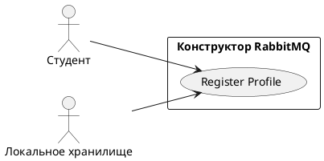

# USE CASE 09 | Register Profile

| Поле | Содержание |
|---|---|
| **USE CASE 09** | Register Profile |
| **Описание** | Студент регистрирует локальный профиль (имя, e-mail) и ожидает, что профиль будет сохранён в браузере и отображаться в интерфейсе как текущий пользователь. |
| **Используется в** | N/A |
| **Предусловия** | Профиль ещё не создан (ключ `rl_user` в локальном хранилище пуст). |
| **Условие успешного завершения** | Профиль (имя, e-mail) записан в локальное хранилище. Интерфейс отображает данные текущего пользователя. |
| **Условие завершения с ошибкой** | Профиль не сохранён. Отображена причина (пустые/некорректные поля, хранилище недоступно). |
| **Акторы** | Студент (первичный). Локальное хранилище браузера (вторичный). |
| **Стимул** | Студент открывает форму регистрации и нажимает «Сохранить профиль». |

## ОСНОВНОЙ ПОТОК (DESCRIPTION)

| Шаг | Действие |
|---|---|
| 1 | Студент открывает форму регистрации профиля. |
| 2 | Студент вводит имя и e-mail. |
| 3 | Система проверяет корректность введённых данных (имя не пустое, e-mail валидный). |
| 4 | Система записывает профиль в локальное хранилище браузера. |
| 5 | Система отображает данные профиля в интерфейсе. |

## РАСШИРЕНИЯ (EXTENSIONS)

| Шаг | Ветвление |
|---|---|
| 3a | Введённые данные некорректны (пустое имя или невалидный e-mail): 3a1. Система отображает причину ошибки. 3a2. Продолжить с шага 2 (студент исправляет данные). |
| 4a | Локальное хранилище недоступно: 4a1. Система отображает причину сбоя. 4a2. Завершить сценарий. |

## ВАРИАЦИИ (VARIATIONS)

| Шаг | Вариант |
|---|---|
| 2 | Студент может указать: · только имя (e-mail опционален) · имя и e-mail |

## СВЯЗИ С ДРУГИМИ USE CASE

- Сам по себе не включает и не вызывается другими UC.

## ДИАГРАММА USE CASE

Собственная диаграмма сценария: [`Диаграмма UC-09.png`](Диаграмма%20UC-09.png). Системная диаграмма всех сценариев — в файле «Диаграмма Use Case системы».

