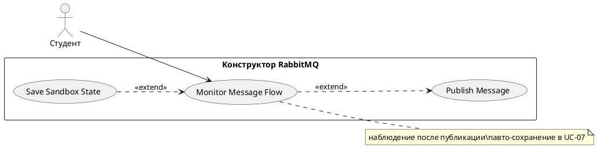

# USE CASE 10 | Monitor Message Flow

| Поле | Содержание |
|---|---|
| **USE CASE 10** | Monitor Message Flow |
| **Описание** | Студент наблюдает за потоком сообщений в топологии (доставка, статусы, метрики, журнал) в реальном времени, управляя симуляцией (пауза, скорость, автоотправка) и ожидая увидеть полное состояние движения сообщений. |
| **Используется в** | N/A |
| **Предусловия** | На холсте загружена топология. Симуляция сообщений активна. |
| **Условие успешного завершения** | Студент видит актуальное состояние потока: статусы сообщений в очередях (ready/unacked/acked/dead-letter), значения метрик, записи журнала. При необходимости симуляция поставлена на паузу или сброшена. |
| **Условие завершения с ошибкой** | Наблюдение не запущено или симуляция не отвечает. Отображена причина. Состояние топологии не изменено. |
| **Акторы** | Студент (первичный). |
| **Стимул** | Студент переходит на панель наблюдения либо публикует первое сообщение (use case 02). |

## ОСНОВНОЙ ПОТОК (DESCRIPTION)

| Шаг | Действие |
|---|---|
| 1 | Система при включённом авто-сохранении выполняет use case 07 (Save Sandbox State) для сохранения текущего состояния песочницы. |
| 2 | Система отображает метрики (published, routed, ready, unacked, acked, dead-letter, dropped). |
| 3 | Система отображает список сообщений с их статусами в очередях. |
| 4 | Система обновляет журнал событий по мере движения сообщений. |
| 5 | Студент управляет симуляцией: пауза/продолжение, скорость, автоотправка. |
| 6 | Система применяет управление и продолжает симуляцию. |

## РАСШИРЕНИЯ (EXTENSIONS)

| Шаг | Ветвление |
|---|---|
| 5a | Студент ставит симуляцию на паузу: 5a1. Система приостанавливает движение сообщений. 5a2. Продолжить с шага 6 (студент может возобновить). |
| 2a | Метрики недоступны (симуляция не запущена): 2a1. Система отображает «симуляция не активна». 2a2. Завершить сценарий. |

## ВАРИАЦИИ (VARIATIONS)

| Шаг | Вариант |
|---|---|
| 5 | Студент может управлять симуляцией: · пауза/продолжение · изменение скорости (тик симуляции) · автоотправка сообщений с заданным интервалом · сброс потока (очистка очередей) |

## СВЯЗИ С ДРУГИМИ USE CASE

- Расширяется: Save Sandbox State (use case 07) — условно, при включённом авто-сохранении (шаг 1).
- Наблюдение становится активным после публикации сообщений (use case 02).

## ДИАГРАММА USE CASE

Собственная диаграмма сценария: [`Диаграмма UC-10.png`](Диаграмма%20UC-10.png). Системная диаграмма всех сценариев — в файле «Диаграмма Use Case системы».

